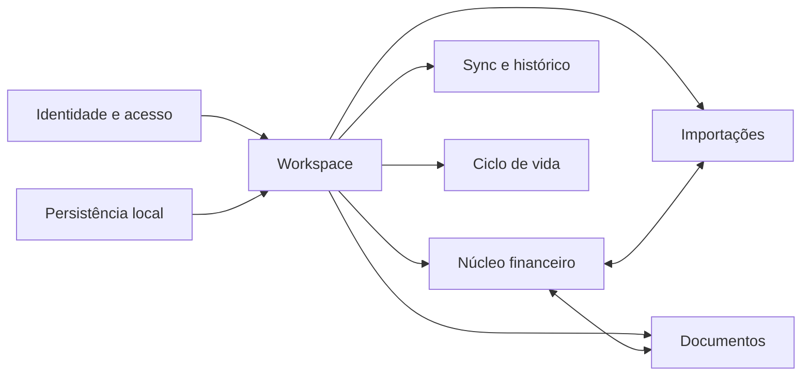
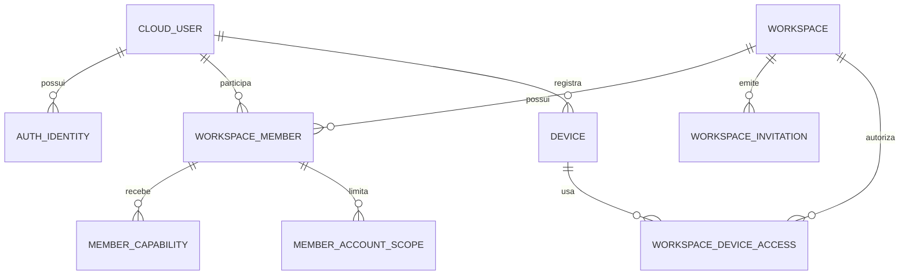
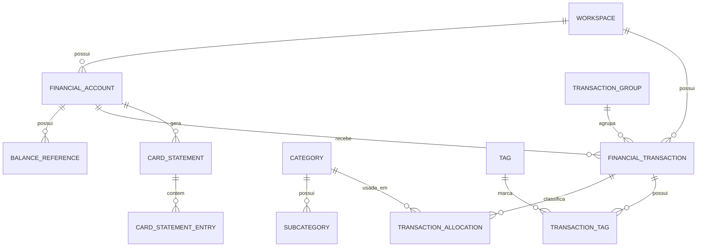
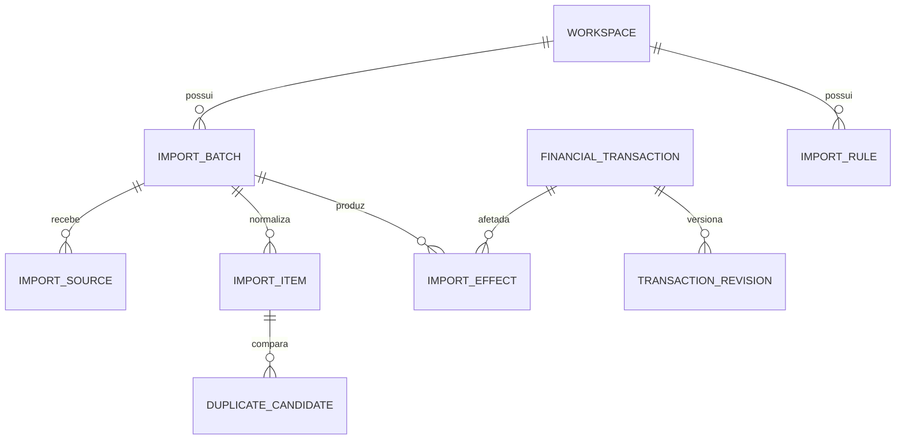
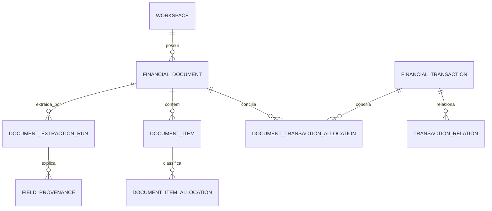
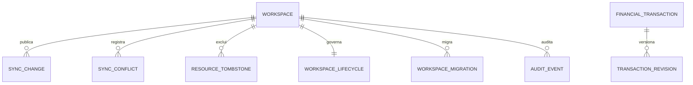

# Financial Manager — Modelo de Dados / ERD
## Documento lógico-relacional · v1.0 · 05/10/2026

**Status:** baseline do MVP para engenharia.  **Fontes:** PRD v1.0 e Mapa de Telas e Fluxos v1.0.  **Plataformas:** Desktop Local + Cloud; Web Cloud; Mobile Cloud.

> Objetivo: transformar os requisitos funcionais em um modelo de dados consistente, auditável e sincronizável, sem obrigar decisões físicas que possam inviabilizar SQLite local, PostgreSQL cloud ou self-host futuro.

## 00 · Decisões de modelagem que orientam o ERD

- **Workspace é a fronteira de dados.** Conta de usuário não é dona automática dos dados; uma pessoa pode participar de muitos workspaces e um workspace cloud possui um proprietário operacional.
- **Modo local não cria usuário remoto anônimo.** O Desktop local possui um cofre; autenticação cloud só aparece quando o usuário decide usar serviços online.
- **Movimentação, classificação, documento e pagamento são conceitos separados.** Isso evita duplicar despesas, permite rateio e mantém conciliações N:N.
- **Dinheiro é exato.** Valores finais usam `MoneyMinor` (inteiro em unidade mínima da moeda) ou mapeamento decimal exato equivalente; IEEE float é proibido para valores financeiros.
- **Original de documento não é entidade persistida no MVP.** Persistem dados extraídos e proveniência mínima; o binário selecionado é temporário.
- **Histórico e reversão são primeira classe.** Importações confirmadas geram efeitos referenciando revisões anteriores/posteriores.
- **Sincronização é versionada.** IDs são gerados no cliente, operações têm idempotência, conflitos são explícitos e exclusões geram tombstones.
- **Storage mode, lifecycle, sync e aprovação não são um único status.** Cada preocupação possui estado próprio.

## 01 · Mapa de domínios

Os domínios compartilham `workspace_id` como primeira barreira de isolamento. A redundância desse campo em registros centrais é intencional: melhora índices, políticas de autorização e verificações de integridade.

## 02 · Convenções de tipos, chaves e tempo

| Convenção | Decisão v1 |
|---|---|
| IDs | UUID gerado pela aplicação; preferir ordenação temporal (ex.: UUIDv7) quando a biblioteca adotada for madura. Nunca depender de autoincremento para entidade sincronizável. |
| Money | `INT64 amount_minor` + `currency_code`; API não usa float. BRL usa centavos no MVP. |
| Quantidade/preço unitário | decimal exato canônico; PostgreSQL pode usar `NUMERIC`, SQLite deve usar representação sem ponto flutuante binário. |
| Datas financeiras | `DATE`; não dependem do fuso do servidor. |
| Instantes técnicos | `TIMESTAMPTZ`/UTC; local converte apenas para exibição. |
| Identificadores fiscais | `TEXT`; forma normalizada em texto alfanumérico quando necessário. |
| JSON | permitido apenas para estruturas realmente variáveis/versionadas: evidências, DSL de regra, snapshots e payloads de sync. |
| Exclusão | lógica + versão/tombstone enquanto houver possibilidade de sincronização; purga física segue ciclo de vida. |

### 02.1 MoneyMinor e sinais
`financial_transaction.account_amount_minor` representa a variação assinada no **saldo exibido daquela conta**. Em conta bancária, despesa normalmente é negativa e receita positiva. Em cartão (passivo), compra aumenta a dívida e portanto pode ser positiva, enquanto pagamento reduz a dívida e é negativo. O campo `economic_kind` determina se o evento é consumo, receita, transferência, liquidação de dívida etc.; relatórios não inferem consumo apenas pelo sinal.

## 03 · Identidade, Workspace e acesso

### Regras principais
1. `cloud_user` só existe para identidade autenticada; Desktop local anônimo não cria linha remota equivalente.
2. `workspace_member` existe apenas no modelo cloud. Um workspace cloud ativo deve possuir exatamente um `OWNER` ativo.
3. Permissão efetiva = papel base + capacidades adicionais/restrições + escopo de contas + estado do workspace/dispositivo.
4. `account_scope_mode=ALL` ignora `member_account_scope`; `SELECTED` exige uma lista explícita. Lista vazia significa acesso a nenhuma conta, não acesso total.
5. `workspace_device_access` controla cache/offline por dispositivo e não concede mais privilégio que o membro já possui.

## 04 · Núcleo financeiro

### 04.1 Por que uma movimentação pertence a uma única conta
O registro `financial_transaction` representa a linha que altera o saldo de uma conta. Operações compostas são agrupadas por `transaction_group`. Assim, uma transferência manual pode criar duas movimentações atomicamente; um pagamento de cartão pode associar a saída bancária à redução da dívida do cartão; e extratos importados de cada lado podem ser conciliados posteriormente sem reescrever toda a identidade do registro.

### 04.2 Classificação não movimenta saldo
`transaction_allocation` distribui o valor de uma movimentação por categoria/subcategoria. Tags são N:N e não participam de soma. Transferências e liquidações de dívida podem não possuir classificação de consumo.

### 04.3 Cartão
O cartão é uma `financial_account` com `balance_nature=LIABILITY`. `card_statement` é apenas a visão de um ciclo observado; `card_statement_entry` vincula compras, parcelas explicitamente informadas, estornos, tarifas ou pagamentos às movimentações já existentes. A fatura não é uma segunda fonte de despesa por si só.

## 05 · Importações, deduplicação e reversão

`import_item` vive na área de preparação e não altera saldo. A confirmação cria `import_effect` para cada consequência persistida. Se o item atualiza uma movimentação já existente, o efeito guarda `before_revision_id` e `after_revision_id`. Desfazer é uma nova operação auditada; nunca significa apagar o lote anterior do histórico.

`import_rule` usa uma DSL versionada em `match_spec/action_spec` porque os critérios podem evoluir (texto, conta, identificador de contraparte etc.). O banco não deve espalhar dezenas de colunas opcionais para cada versão de regra.

## 06 · Documentos, itens e conciliação

A entidade `financial_document` contém o estado confirmado do documento; cada nova tentativa de extração cria `document_extraction_run`. A proveniência de campos relevantes fica em `field_provenance`, permitindo mostrar de onde veio um valor sem conservar o PDF/XML/imagem original.

A relação `document_transaction_allocation` é N:N e possui valor. Portanto, um documento pode ser liquidado por vários pagamentos e uma movimentação pode cobrir vários documentos. O estado `PROPOSED` suporta conciliação assistida sem modificar a verdade financeira antes da confirmação humana.

## 07 · Histórico, sincronização, conflitos e ciclo de vida

`transaction_revision` é histórico funcional da movimentação e pode conter snapshot canônico. `audit_event` registra a ação e o ator; ele não substitui a revisão nem deve virar uma cópia irrestrita do dado financeiro. `sync_change` é o feed ordenado do servidor. `resource_tombstone` mantém a informação mínima necessária para impedir que um cliente antigo ressuscite um registro apagado.

A migração Local <-> Cloud altera a **geração de sincronização**. Operações offline de uma geração anterior são recusadas/reconciliadas explicitamente. Isso é diferente de `workspace_lifecycle`, que controla ACTIVE/ARCHIVED/DELETE_REQUESTED/PURGED.

## 08 · Catálogo de entidades

| Entidade | Persistência | Prioridade | Responsabilidade | Relações-chave |
|---|---|---|---|---|
| cloud_user | Cloud | P0 | Identidade autenticada do usuário; não existe para o modo local anônimo. | auth_identity, workspace_member, device |
| auth_identity | Cloud | P0 | Vínculo de autenticação por e-mail, Google ou Apple. | cloud_user |
| workspace | Local + Cloud | P0 | Fronteira principal dos dados, configuração e futura cobrança. | quase todos os domínios |
| workspace_member | Cloud | P0 | Participação de um usuário em um workspace e seu papel base. | cloud_user, workspace |
| member_capability | Cloud | P0 | Concessão/negação explícita de capacidades especiais, como exportação. | workspace_member |
| member_account_scope | Cloud | P0 | Lista de contas permitidas quando o membro não possui escopo ALL. | workspace_member, financial_account |
| workspace_invitation | Cloud | P0 | Convite com papel, escopo, expiração e estado. | workspace |
| device | Cloud | P0 | Dispositivo autenticado conhecido; não representa o cofre local anônimo. | cloud_user |
| workspace_device_access | Cloud + cache cliente | P0 | Autorização offline, cursor de sync e expiração por workspace/dispositivo. | workspace, device |
| support_access_grant | Cloud | P0 | Acesso temporário de suporte concedido pelo proprietário. | workspace, workspace_member |
| external_processing_authorization | Cloud | Evolução | Autorização de produto para IA/OCR externo, separada da simples ida para nuvem. | workspace |
| workspace_lifecycle | Cloud | P0 | Arquivamento, exclusão programada e conclusão de purga. | workspace |
| workspace_migration | Local + Cloud | P0 | Controle transacional de Local→Cloud e Cloud→Local. | workspace |
| financial_account | Local + Cloud | P0 | Conta corrente, poupança, digital, dinheiro, cartão ou conta patrimonial simples. | workspace |
| balance_reference | Local + Cloud | P0 | Saldo inicial ou referência de conferência com data e posição no dia. | financial_account |
| financial_transaction | Local + Cloud | P0 | Movimentação de uma conta; unidade central de saldo e histórico. | financial_account, transaction_group |
| transaction_group | Local + Cloud | P0 | Agrupa movimentações que formam uma operação composta, como transferência ou pagamento de cartão. | financial_transaction |
| transaction_allocation | Local + Cloud | P0 | Rateio/classificação monetária de uma movimentação. | financial_transaction, category, subcategory |
| category | Local + Cloud | P0 | Categoria configurável por workspace. | workspace |
| subcategory | Local + Cloud | P0 | Subcategoria definida pelo usuário dentro de uma categoria. | category |
| tag | Local + Cloud | P0 | Marcador livre do usuário. | workspace |
| transaction_tag | Local + Cloud | P0 | Relação N:N entre movimentações e tags. | financial_transaction, tag |
| counterparty | Local + Cloud | P0 | Pessoa/organização leve associável a movimentos e documentos. | workspace |
| card_statement | Local + Cloud | P0 | Período/fatura observada de um cartão. | financial_account |
| card_statement_entry | Local + Cloud | P0 | Associa itens/pagamentos observados na fatura a movimentações. | card_statement, financial_transaction |
| scheduled_commitment | Local + Cloud | P1 | Compromisso futuro simples, sem alterar saldo realizado. | workspace, financial_account |
| import_batch | Local + Cloud | P0 | Unidade reversível de importação ou reversão. | workspace, financial_account |
| import_source | Local + Cloud | P0 | Metadados do arquivo e do parser, sem guardar o arquivo original. | import_batch |
| import_item | Local + Cloud | P0 | Linha normalizada ainda revisável ou já processada de um lote. | import_batch |
| duplicate_candidate | Local + Cloud | P0 | Possível repetição encontrada na revisão, com evidências e decisão. | import_item, financial_transaction |
| import_effect | Local + Cloud | P0 | Efeito confirmado do lote sobre dados persistidos e revisões. | import_batch, financial_transaction, transaction_revision |
| import_rule | Local + Cloud | P0 | Regra versionada de renomeação/categorização para futuras importações. | workspace |
| financial_document | Local + Cloud | P0 | Documento fiscal/comprovante extraído, sem o binário original no MVP. | workspace, counterparty |
| document_extraction_run | Local + Cloud | P0 | Execução de um leitor e metadados da fonte selecionada. | financial_document |
| field_provenance | Local + Cloud | P0 | Proveniência de campos relevantes da extração. | document_extraction_run |
| document_item | Local + Cloud | P0 | Item detalhado de nota/documento. | financial_document |
| document_item_allocation | Local + Cloud | P0 | Classificação/rateio opcional de um item. | document_item, category, subcategory |
| document_transaction_allocation | Local + Cloud | P0 | Conciliação N:N entre documentos e movimentações, com valor alocado. | financial_document, financial_transaction |
| transaction_relation | Local + Cloud | P0 | Vínculo semântico entre movimentações, como estorno, duplicidade ou substituição. | financial_transaction |
| transaction_revision | Local + Cloud | P0 | Snapshot imutável por versão usado em histórico, conflito e reversão. | financial_transaction |
| audit_event | Local + Cloud | P0 | Trilha de ações; cloud protegida, local mantida no próprio cofre. | workspace |
| sync_change | Cloud | P0 | Feed ordenado de alterações confirmado pelo servidor. | workspace |
| sync_conflict | Cloud + cliente | P0 | Conflito explícito entre versão-base, proposta local e versão remota. | workspace |
| resource_tombstone | Cloud | P0 | Marcador versionado de exclusão para evitar ressurreição por clientes antigos. | workspace |
| local_vault_metadata | Desktop local | P0 técnico | Metadados do cofre criptografado; sem usuário remoto anônimo. | instalação Desktop |
| workspace_replica_meta | Desktop/Mobile | P0 técnico | Distingue autoridade local de réplica cloud e armazena geração/cursor. | workspace |
| sync_operation_queue | Desktop/Mobile | P0 técnico | Fila persistente idempotente de operações offline cloud. | workspace_replica_meta |
| backup_manifest | Arquivo de backup | P0 técnico | Manifesto versionado e autenticado dentro do pacote de backup; não é tabela operacional. | workspace |

## 09 · Dicionário de dados — entidades centrais

### `workspace`

| Campo | Tipo lógico | Obrigatório | Regra/observação |
|---|---|---|---|
| `id` | UUID | Sim | Gerado no cliente quando local; preservado na migração. |
| `display_name` | TEXT | Sim | Nome exibido ao usuário. |
| `purpose` | ENUM | Sim | PERSONAL / BUSINESS / OTHER. |
| `storage_mode` | ENUM | Sim | LOCAL / CLOUD. Não representa arquivamento. |
| `default_currency` | CHAR(3) | Sim | BRL no MVP; modelo preparado para ISO 4217. |
| `legal_name` | TEXT | Não | Nome civil/empresarial opcional. |
| `tax_identifier` | TEXT | Não | CPF/CNPJ como texto; nunca tipo numérico. |
| `legal_nature` | TEXT | Não | Campo livre/estruturável no futuro. |
| `sync_generation` | UUID/INT64 | Sim | Muda quando a autoridade de sincronização é invalidada/migrada. |
| `created_at` | TIMESTAMPTZ | Sim | Instante técnico em UTC. |

### `workspace_member`

| Campo | Tipo lógico | Obrigatório | Regra/observação |
|---|---|---|---|
| `id` | UUID | Sim | Identificador da participação. |
| `workspace_id` | UUID FK | Sim | Mesmo workspace dos recursos acessíveis. |
| `user_id` | UUID FK | Sim | Usuário cloud. |
| `role` | ENUM | Sim | OWNER / ADMIN / EDITOR / READER. |
| `status` | ENUM | Sim | ACTIVE / SUSPENDED / REVOKED. |
| `account_scope_mode` | ENUM | Sim | ALL / SELECTED; evita ambiguidade de lista vazia. |
| `joined_at` | TIMESTAMPTZ | Sim | Aceite efetivo. |
| `revoked_at` | TIMESTAMPTZ | Não | Revogação. |

### `financial_account`

| Campo | Tipo lógico | Obrigatório | Regra/observação |
|---|---|---|---|
| `id` | UUID | Sim | Estável offline/cloud. |
| `workspace_id` | UUID FK | Sim | Fronteira de isolamento. |
| `name` | TEXT | Sim | Nome amigável. |
| `account_kind` | ENUM | Sim | CHECKING / SAVINGS / DIGITAL / CASH / CREDIT_CARD / INVESTMENT_SIMPLE / LOAN_SIMPLE / OTHER. |
| `balance_nature` | ENUM | Sim | ASSET / LIABILITY; cartão normalmente LIABILITY. |
| `currency_code` | CHAR(3) | Sim | BRL no MVP. |
| `status` | ENUM | Sim | ACTIVE / ARCHIVED. |
| `institution_name` | TEXT | Não | Banco/emissor informado pelo usuário ou fonte. |
| `created_at` | TIMESTAMPTZ | Sim | Auditoria técnica. |

### `balance_reference`

| Campo | Tipo lógico | Obrigatório | Regra/observação |
|---|---|---|---|
| `id` | UUID | Sim | Identificador. |
| `account_id` | UUID FK | Sim | Conta referenciada. |
| `amount_minor` | INT64 | Sim | Saldo exato em unidade mínima da moeda. |
| `reference_date` | DATE | Sim | Data financeira da referência. |
| `day_position` | ENUM | Sim | START_OF_DAY / END_OF_DAY. |
| `source` | ENUM | Sim | MANUAL / STATEMENT / IMPORT. |
| `status` | ENUM | Sim | ACTIVE / SUPERSEDED. |
| `created_at` | TIMESTAMPTZ | Sim | Mantém histórico de referências. |

### `financial_transaction`

| Campo | Tipo lógico | Obrigatório | Regra/observação |
|---|---|---|---|
| `id` | UUID | Sim | Gerado antes do sync; nunca autoincremento global. |
| `workspace_id` | UUID FK | Sim | Redundância intencional para isolamento/índices. |
| `account_id` | UUID FK | Sim | Uma movimentação pertence a uma conta. |
| `group_id` | UUID FK | Não | Transferência/pagamento de cartão/operação composta. |
| `counterparty_id` | UUID FK | Não | Contraparte normalizada, quando conhecida. |
| `financial_date` | DATE | Sim | Base principal de relatórios de consumo. |
| `account_amount_minor` | INT64 | Sim | Variação assinada no saldo exibido da conta. |
| `economic_kind` | ENUM | Sim | INCOME / EXPENSE / EXPENSE_REVERSAL / TRANSFER / DEBT_SETTLEMENT / ADJUSTMENT / OTHER. |
| `original_description` | TEXT | Não | Texto recebido da fonte; imutável salvo correção explícita de origem. |
| `display_name` | TEXT | Sim | Nome amigável editável. |
| `origin_kind` | ENUM | Sim | MANUAL / IMPORT / DOCUMENT / SYSTEM. |
| `version` | INT64 | Sim | Controle otimista; incrementa a cada revisão. |
| `deleted_at` | TIMESTAMPTZ | Não | Exclusão lógica sincronizável. |
| `created_at/updated_at` | TIMESTAMPTZ | Sim | Instantes técnicos. |

### `transaction_group`

| Campo | Tipo lógico | Obrigatório | Regra/observação |
|---|---|---|---|
| `id` | UUID | Sim | Identificador da operação composta. |
| `workspace_id` | UUID FK | Sim | Impede agrupamento entre workspaces. |
| `group_type` | ENUM | Sim | TRANSFER / CARD_PAYMENT / OTHER_COMPOSITE. |
| `state` | ENUM | Sim | ACTIVE / BROKEN / VOIDED. |
| `created_at` | TIMESTAMPTZ | Sim | Histórico. |

### `transaction_allocation`

| Campo | Tipo lógico | Obrigatório | Regra/observação |
|---|---|---|---|
| `id` | UUID | Sim | Parcela de classificação. |
| `transaction_id` | UUID FK | Sim | Movimentação classificada. |
| `category_id` | UUID FK | Sim | Categoria do mesmo workspace. |
| `subcategory_id` | UUID FK | Não | Deve pertencer à categoria escolhida. |
| `amount_minor` | INT64 | Sim | Valor absoluto da parcela; > 0. |
| `note` | TEXT | Não | Observação da parcela. |

### `category`

| Campo | Tipo lógico | Obrigatório | Regra/observação |
|---|---|---|---|
| `id` | UUID | Sim | Identificador. |
| `workspace_id` | UUID FK | Sim | Categoria não cruza workspace. |
| `name` | TEXT | Sim | Editável. |
| `category_scope` | ENUM | Sim | EXPENSE / INCOME / BOTH. |
| `sort_order` | INT | Sim | Ordem customizada. |
| `status` | ENUM | Sim | ACTIVE / ARCHIVED. |
| `is_seeded` | BOOLEAN | Sim | Indica sugestão inicial, não imutabilidade. |

### `import_batch`

| Campo | Tipo lógico | Obrigatório | Regra/observação |
|---|---|---|---|
| `id` | UUID | Sim | Lote reversível. |
| `workspace_id` | UUID FK | Sim | Fronteira. |
| `target_account_id` | UUID FK | Não | Conta escolhida; pode ser nulo em documento/multifonte futura. |
| `batch_kind` | ENUM | Sim | IMPORT / REVERSAL. |
| `status` | ENUM | Sim | PREPARING / REVIEW / CONFIRMING / COMMITTED / FAILED / REVERSED / PARTIALLY_REVERSED. |
| `reverses_batch_id` | UUID FK | Não | Aponta para lote anterior quando for reversão. |
| `created_by_member_id` | UUID FK | Não | Nulo em local anônimo. |
| `created_at/committed_at` | TIMESTAMPTZ | Sim/Não | Ciclo do lote. |

### `import_item`

| Campo | Tipo lógico | Obrigatório | Regra/observação |
|---|---|---|---|
| `id` | UUID | Sim | Linha normalizada. |
| `batch_id` | UUID FK | Sim | Lote. |
| `row_no` | INT | Não | Posição da fonte quando aplicável. |
| `source_external_id` | TEXT | Não | FITID/identificador confiável quando disponível. |
| `normalized_date` | DATE | Sim | Data interpretada. |
| `normalized_amount_minor` | INT64 | Sim | Valor assinado conforme a conta destino. |
| `original_description` | TEXT | Não | Texto da fonte. |
| `proposed_name` | TEXT | Não | Resultado de regras/normalização. |
| `disposition` | ENUM | Sim | NEW / DUPLICATE / POSSIBLE_DUPLICATE / UPDATE / INVALID / SKIPPED / COMMITTED. |
| `validation_errors` | JSON/TEXT | Não | Erros estruturados; não contém arquivo inteiro. |

### `import_effect`

| Campo | Tipo lógico | Obrigatório | Regra/observação |
|---|---|---|---|
| `id` | UUID | Sim | Efeito confirmado. |
| `batch_id` | UUID FK | Sim | Lote causador. |
| `import_item_id` | UUID FK | Sim | Linha causadora. |
| `transaction_id` | UUID FK | Sim | Registro afetado. |
| `action` | ENUM | Sim | CREATE / UPDATE / LINK / UNLINK / RESTORE / DELETE. |
| `before_revision_id` | UUID FK | Não | Estado anterior para reversão segura. |
| `after_revision_id` | UUID FK | Não | Estado resultante. |
| `created_at` | TIMESTAMPTZ | Sim | Auditoria. |

### `financial_document`

| Campo | Tipo lógico | Obrigatório | Regra/observação |
|---|---|---|---|
| `id` | UUID | Sim | Documento persistido após revisão. |
| `workspace_id` | UUID FK | Sim | Fronteira. |
| `issuer_counterparty_id` | UUID FK | Não | Emitente normalizado. |
| `document_type` | ENUM | Sim | NFE / NFCE / NFSE / RECEIPT / BOLETO / PIX_RECEIPT / INVOICE / OTHER. |
| `external_key` | TEXT | Não | Chave/identificador da fonte, quando houver. |
| `issue_date` | DATE | Não | Data do documento. |
| `total_amount_minor` | INT64 | Sim | Total final exato. |
| `total_discount_minor` | INT64 | Sim | Default 0. |
| `total_surcharge_minor` | INT64 | Sim | Default 0. |
| `state` | ENUM | Sim | DRAFT_REVIEW / CONFIRMED / VOIDED. |
| `created_at` | TIMESTAMPTZ | Sim | Persistência. |

### `document_item`

| Campo | Tipo lógico | Obrigatório | Regra/observação |
|---|---|---|---|
| `id` | UUID | Sim | Item pesquisável. |
| `document_id` | UUID FK | Sim | Documento. |
| `line_no` | INT | Não | Linha/origem. |
| `original_description` | TEXT | Sim | Descrição extraída. |
| `display_name` | TEXT | Sim | Descrição ajustável. |
| `quantity_decimal` | DECIMAL_EXACT | Não | Quantidade exata; nunca float binário. |
| `unit` | TEXT | Não | Unidade da fonte. |
| `unit_price_decimal` | DECIMAL_EXACT | Não | Pode ter mais casas que a moeda. |
| `discount_minor` | INT64 | Sim | Default 0. |
| `surcharge_minor` | INT64 | Sim | Default 0. |
| `net_amount_minor` | INT64 | Sim | Valor líquido da linha. |

### `document_transaction_allocation`

| Campo | Tipo lógico | Obrigatório | Regra/observação |
|---|---|---|---|
| `id` | UUID | Sim | Vínculo de conciliação. |
| `document_id` | UUID FK | Sim | Documento. |
| `transaction_id` | UUID FK | Sim | Movimentação. |
| `relation_type` | ENUM | Sim | PURCHASE / PAYMENT / EVIDENCE. |
| `allocated_amount_minor` | INT64 | Sim | Valor > 0; permite N:N. |
| `state` | ENUM | Sim | PROPOSED / CONFIRMED / REJECTED. |
| `match_score` | DECIMAL/INT | Não | Apenas sugestão; nunca confirma sozinho. |
| `evidence` | JSON/TEXT | Não | Razões do match, sem conteúdo binário. |

### `transaction_revision`

| Campo | Tipo lógico | Obrigatório | Regra/observação |
|---|---|---|---|
| `id` | UUID | Sim | Revisão imutável. |
| `transaction_id` | UUID FK | Sim | Movimentação. |
| `version` | INT64 | Sim | Mesmo número aplicado ao registro atual. |
| `snapshot` | JSON/TEXT | Sim | Snapshot canônico dos campos e relações essenciais. |
| `actor_type` | ENUM | Sim | LOCAL_USER / MEMBER / SYSTEM / SUPPORT. |
| `actor_id` | UUID/TEXT | Não | Membro/ator quando aplicável. |
| `device_id` | UUID | Não | Dispositivo cloud conhecido. |
| `change_source` | ENUM | Sim | MANUAL / IMPORT / SYNC_RESOLUTION / REVERSAL / MIGRATION / SYSTEM. |
| `created_at` | TIMESTAMPTZ | Sim | Ordem histórica. |

### `sync_change`

| Campo | Tipo lógico | Obrigatório | Regra/observação |
|---|---|---|---|
| `id` | UUID | Sim | Registro de feed. |
| `workspace_id` | UUID FK | Sim | Stream isolado por workspace. |
| `generation` | UUID/INT64 | Sim | Deve coincidir com a geração ativa. |
| `sequence` | INT64 | Sim | Monótono por workspace/geração. |
| `resource_type` | TEXT/ENUM | Sim | Tipo sincronizável. |
| `resource_id` | UUID | Sim | ID estável. |
| `resource_version` | INT64 | Sim | Versão confirmada. |
| `operation` | ENUM | Sim | UPSERT / DELETE. |
| `committed_at` | TIMESTAMPTZ | Sim | Servidor. |

### `sync_conflict`

| Campo | Tipo lógico | Obrigatório | Regra/observação |
|---|---|---|---|
| `id` | UUID | Sim | Conflito. |
| `workspace_id` | UUID FK | Sim | Fronteira. |
| `resource_type/resource_id` | TEXT + UUID | Sim | Recurso em disputa. |
| `base_version` | INT64 | Sim | Versão conhecida pelo cliente. |
| `remote_version` | INT64 | Sim | Versão confirmada no servidor. |
| `local_operation_id` | UUID | Sim | Operação idempotente do cliente. |
| `local_proposal` | JSON/TEXT | Sim | Payload necessário para comparação. |
| `state` | ENUM | Sim | OPEN / RESOLVED / DISCARDED. |
| `resolved_version` | INT64 | Não | Nova revisão após decisão. |

### `workspace_migration`

| Campo | Tipo lógico | Obrigatório | Regra/observação |
|---|---|---|---|
| `id` | UUID | Sim | Operação de migração. |
| `workspace_id` | UUID | Sim | Mantém identidade lógica do espaço. |
| `direction` | ENUM | Sim | LOCAL_TO_CLOUD / CLOUD_TO_LOCAL. |
| `status` | ENUM | Sim | PREPARING / SNAPSHOT_READY / TRANSFERRING / VERIFYING / COMMITTED / FAILED / CANCELLED. |
| `source_generation` | UUID/INT64 | Sim | Geração anterior. |
| `target_generation` | UUID/INT64 | Sim | Nova autoridade. |
| `snapshot_hash` | TEXT | Não | Integridade do snapshot. |
| `expected_counts` | JSON/TEXT | Não | Contagens/totais para verificação, sem substituir dados. |
| `started_at/completed_at` | TIMESTAMPTZ | Sim/Não | Ciclo. |

## 10 · Entidades auxiliares — esquema compacto

- **`auth_identity`** — id, user_id, provider, provider_subject, verified_at; UQ(provider, provider_subject).
- **`member_capability`** — id, member_id, capability, enabled; UQ(member_id, capability).
- **`member_account_scope`** — id, member_id, account_id; UQ(member_id, account_id).
- **`workspace_invitation`** — id, workspace_id, recipient, role, scope_spec, token_hash, expires_at, status, accepted_by_user_id?.
- **`device`** — id, user_id, platform, public_label, status, registered_at, last_seen_at.
- **`workspace_device_access`** — id, workspace_id, device_id, offline_enabled, generation, last_server_sequence, last_sync_at, access_expires_at, revoked_at.
- **`support_access_grant`** — id, workspace_id, granted_by_member_id, support_subject_id, scope_spec, reason, granted_at, expires_at, revoked_at; exportação false no perfil padrão.
- **`external_processing_authorization`** — id, workspace_id, feature, provider, data_scope, policy_version, granted_by_member_id, granted_at, revoked_at. Fora do MVP operacional.
- **`workspace_lifecycle`** — workspace_id PK/FK, state, archived_at, scheduled_delete_at, delete_requested_at, purge_completed_at.
- **`counterparty`** — id, workspace_id, display_name, identifier_type?, identifier_value?, relationship_hint, status.
- **`subcategory`** — id, category_id, name, sort_order, status.
- **`tag`** — id, workspace_id, name, status; nomes ativos únicos de forma normalizada por workspace.
- **`transaction_tag`** — transaction_id, tag_id; PK composta.
- **`card_statement`** — id, card_account_id, period_start, period_end, closing_date?, due_date?, reported_total_minor?, external_reference?, status.
- **`card_statement_entry`** — id, statement_id, transaction_id, entry_type, installment_no?, installment_total?, source_line_ref?.
- **`scheduled_commitment`** — id, workspace_id, account_id?, due_date, amount_minor, currency_code, description, recurrence_rule?, status, realized_transaction_id?. P1.
- **`import_source`** — id, batch_id, file_name, file_hash, format, parser_name, parser_version, detected_currency?, period_start?, period_end?, imported_at; não guarda conteúdo do arquivo.
- **`duplicate_candidate`** — id, import_item_id, candidate_transaction_id?, candidate_import_item_id?, score, evidence, resolution; CHECK exatamente um candidato.
- **`import_rule`** — id, workspace_id, name, priority, enabled, match_spec, action_spec, version, created_at, updated_at.
- **`document_extraction_run`** — id, document_id, source_kind, file_name, file_hash, reader_name, reader_version, extracted_at, completed_state; original não persistido.
- **`field_provenance`** — id, extraction_run_id, field_path, source_locator, extraction_method, confidence?, raw_value_hint?; não guardar documento inteiro.
- **`document_item_allocation`** — id, document_item_id, category_id, subcategory_id?, amount_minor.
- **`transaction_relation`** — id, workspace_id, transaction_a_id, transaction_b_id, relation_type, state, created_at; UQ normalizada do par + tipo.
- **`audit_event`** — id, workspace_id, actor_type, actor_id?, device_id?, action, resource_type, resource_id?, metadata_minimal, occurred_at. Sem payload financeiro completo por padrão.
- **`resource_tombstone`** — id, workspace_id, generation, resource_type, resource_id, delete_version, delete_sequence, deleted_at, purge_after.
- **`local_vault_metadata`** — vault_id, schema_version, encryption_version, created_at, key_locator. `key_locator` é referência ao mecanismo seguro do SO, nunca a chave em texto.
- **`workspace_replica_meta`** — workspace_id, authority_kind(LOCAL_AUTHORITY|CLOUD_REPLICA), generation, last_server_sequence, last_sync_at, cache_expires_at?.
- **`sync_operation_queue`** — op_id, workspace_id, generation, idempotency_key, resource_type, resource_id, base_version, operation, payload, state, attempts, created_at, last_error_code?.
- **`backup_manifest`** — workspace_id, schema_version, created_at, app_version, record_counts, integrity_hashes, encryption_descriptor. Vive dentro do pacote criptografado.

## 11 · Máquinas de estado

| Recurso | Fluxo principal | Observação |
|---|---|---|
| Workspace cloud | ACTIVE → ARCHIVED → DELETE_REQUESTED → PURGED | Arquivar interrompe escrita/sync; exclusão definitiva não reutiliza ACTIVE automaticamente. |
| ImportBatch | PREPARING → REVIEW → CONFIRMING → COMMITTED; COMMITTED → REVERSED/PARTIALLY_REVERSED | FAILED/CANCELLED podem ocorrer antes do commit; reversão é nova operação auditada. |
| DocumentTransactionAllocation | PROPOSED → CONFIRMED ou REJECTED | Sugestão nunca muda saldo sozinha. |
| SyncConflict | OPEN → RESOLVED ou DISCARDED | Resolver cria nova versão; não sobrescreve silenciosamente alternativas. |
| WorkspaceMigration | PREPARING → SNAPSHOT_READY → TRANSFERRING → VERIFYING → COMMITTED | Falha antes de COMMITTED preserva autoridade da origem. |
| ScheduledCommitment · P1 | PLANNED → REALIZED ou CANCELLED | REALIZED vincula uma movimentação confirmada; não cria duplicata. |

## 12 · Invariantes e constraints de negócio

- **I-01** — Todo registro de negócio com workspace_id deve referenciar o mesmo workspace em suas FKs relacionadas.
- **I-02** — IDs de entidades sincronizáveis são gerados fora do banco e permanecem estáveis entre Local e Cloud.
- **I-03** — Valores monetários finais nunca usam float binário; Money usa unidades mínimas inteiras ou mapeamento decimal exato equivalente.
- **I-04** — A soma de transaction_allocation.amount_minor deve igualar |account_amount_minor| para movimentos classificáveis, salvo ajuste explícito documentado.
- **I-05** — Subcategory usada em um rateio deve pertencer à Category usada no mesmo rateio.
- **I-06** — Transferências internas e pagamentos de cartão não entram como despesa de consumo; group_type/economic_kind determinam a leitura.
- **I-07** — Um workspace cloud ativo possui exatamente um OWNER ativo.
- **I-08** — member_account_scope só é interpretado quando account_scope_mode=SELECTED.
- **I-09** — Uma linha de importação não altera saldo antes de o lote ser COMMITTED.
- **I-10** — Repetir o mesmo idempotency_key de import/sync não cria novo efeito.
- **I-11** — Reversão de lote usa revisões anteriores e falha/solicita decisão quando houve edição posterior incompatível.
- **I-12** — Original de documento não é persistido no MVP; hash/nome/versão do leitor não devem permitir reconstruí-lo.
- **I-13** — Soma confirmada das alocações documento <-> transação não pode exceder o valor disponível sem ajuste explícito.
- **I-14** — Exclusão sincronizada gera tombstone antes de purga para impedir ressurreição por clientes antigos.
- **I-15** — Operação offline com geração antiga é rejeitada após migração Local <-> Cloud ou revogação equivalente.
- **I-16** — Uma conta ou membro de outro workspace nunca pode ser referenciado por atalho de ID mesmo que a API receba um UUID válido.
- **I-17** — Tax identifiers permanecem texto; normalização preserva zeros iniciais e aceita formato alfanumérico aplicável.
- **I-18** — Logs técnicos e audit_event não armazenam documentos, itens ou descrições financeiras completos por padrão.

### 12.1 Constraints que devem existir também no banco
Mesmo com validação de domínio, o banco deve reforçar unicidade, `NOT NULL`, FKs, checks de valores positivos e índices únicos parciais quando suportados. Regras que envolvem soma entre várias linhas ou estados concorrentes podem exigir transação serializável/lock lógico, trigger cuidadosamente testado ou validação no serviço dentro de uma transação.

## 13 · Índices e acesso esperado

| Entidade | Índice/constraint | Motivo |
|---|---|---|
| financial_transaction | (workspace_id, financial_date DESC) | Lista, dashboard e relatórios por período. |
| financial_transaction | (account_id, financial_date DESC) | Extrato de conta. |
| financial_transaction | (workspace_id, display_name normalized) | Busca textual; usar mecanismo apropriado de acentos. |
| transaction_allocation | (category_id, transaction_id) | Relatório por categoria. |
| transaction_tag | UNIQUE(transaction_id, tag_id) | Evita tag duplicada. |
| category | UNIQUE parcial(workspace_id, normalized_name) WHERE status=ACTIVE | Evita categorias ativas equivalentes. |
| workspace_member | UNIQUE(workspace_id, user_id) para participação ativa | Evita duplicidade de membro. |
| workspace_member | UNIQUE parcial(workspace_id) WHERE role=OWNER AND status=ACTIVE | Garante um proprietário ativo. |
| import_source | (file_hash, workspace_id) | Reconhece reenvio de arquivo sem depender apenas disso. |
| import_item | (batch_id, row_no) | Navegação da revisão. |
| import_item | (source_external_id, batch_id) | Idempotência quando fonte oferece ID. |
| financial_document | (workspace_id, external_key) | Evita nota duplicada quando chave é confiável. |
| document_item | índice de busca normalizada por description/display_name | Busca por produto como “energético”. |
| sync_change | UNIQUE(workspace_id, generation, sequence) | Feed determinístico. |
| resource_tombstone | UNIQUE(workspace_id, generation, resource_type, resource_id) | Uma exclusão ativa por recurso/geração. |
| audit_event | (workspace_id, occurred_at DESC) | Auditoria por período. |

### 13.1 Escala
O objetivo próximo de 100 mil usuários não exige sharding no MVP. O desenho prioriza isolamento por `workspace_id`, índices compostos por data e paginação por cursor. Tabelas que crescem rapidamente — `financial_transaction`, `document_item`, `audit_event` e `sync_change` — devem ter planos de retenção/particionamento avaliados conforme volume real, não prematuramente.

## 14 · Mapeamento Local, Cloud e cache offline

| Componente | Desktop Local | Desktop Cloud | Web Cloud | Mobile Cloud |
|---|---|---|---|---|
| Workspace de autoridade | SQLite/cofre criptografado | PostgreSQL cloud | PostgreSQL cloud | PostgreSQL cloud |
| Core financeiro | Completo local | réplica/cache conforme autorização | servidor; sem workspace local | cache criptografado quando offline autorizado |
| Identidade/membros | não existem para local anônimo | servidor | servidor | servidor |
| Fila de sync | não necessária no espaço exclusivamente local | persistente no cliente | não obrigatória no MVP | persistente no cliente |
| Backup manual | pacote criptografado | exportação/backup local apenas se permitido pelo produto; não confundir com backup de servidor | não | não no MVP |
| Originais de documentos | temporários e descartados | temporários e descartados | temporários no serviço e descartados | temporários e descartados |

### 14.1 Autoridade do dado
`workspace_replica_meta.authority_kind` evita confundir um workspace local, cuja cópia Desktop é a autoridade, com um cache cloud. Fazer login não muda essa autoridade. A migração só muda a autoridade após snapshot, transferência e verificação concluídos.

## 15 · Privacidade e minimização no schema

- Dados pessoais opcionais do workspace são separados dos registros financeiros e podem permanecer nulos.
- Arquivos fiscais originais não entram em backups ou logs do MVP; `file_hash` é usado apenas para integridade/deduplicação e deve possuir política de retenção coerente.
- `audit_event.metadata_minimal` deve conter IDs, ação e razões técnicas; descrições e itens completos só entram se indispensáveis e explicitamente previstos.
- Tokens de convite, recuperação e suporte são armazenados como hash quando funcionam como segredo de posse.
- Índices de busca não podem formar um repositório independente que sobreviva à exclusão do dado de origem.
- Dados de outro workspace nunca são “filtrados depois”; queries e políticas partem de `workspace_id` autorizado.

## 16 · Busca e normalização textual

A busca deve preservar o texto original e manter representações normalizadas deriváveis para comparação sem acento/caixa. Para cloud, pode-se usar índice de busca do PostgreSQL/trigramas conforme prova de desempenho. Para SQLite local, usar FTS quando necessário. A normalização é um índice derivado e deve ser recriável; não substitui `original_description`, `display_name` ou descrição de item.

## 17 · Estratégia de versionamento e migrações de schema

1. Toda versão do Desktop conhece `schema_version` do cofre local e do `backup_manifest`.
2. Migrações locais são transacionais quando possível e fazem backup/checagem antes de mudanças destrutivas.
3. API cloud aceita versões de cliente dentro de uma janela suportada e nunca interpreta payload antigo como estrutura nova sem adaptador.
4. `import_source.parser_version`, `document_extraction_run.reader_version` e `import_rule.version` permitem reproduzir decisões sem supor que parsers são imutáveis.
5. Exportação JSON completa possui `export_schema_version` independente da versão interna do banco.

## 18 · Extensões previstas, mas não implementadas no MVP

- **Open Finance:** adicionar `bank_connection`, `bank_consent`, `external_account_binding` e `external_sync_cursor` sem mudar `financial_transaction` como núcleo.
- **Aprovação em dois níveis:** adicionar `approval_case` e `approval_step`; não sobrecarregar `financial_transaction.status`.
- **IA externa/OCR remoto:** usar `external_processing_authorization` e registros de execução com escopo; desligado por padrão.
- **Contas a pagar/receber:** entidades de obrigação/recebível podem realizar-se em uma ou várias `financial_transaction`; `scheduled_commitment` não será promovido silenciosamente a módulo contábil.
- **Centro de custo/projeto:** futura dimensão de classificação ligada a `transaction_allocation`, sem substituir categoria/tag.
- **Multimoeda real:** manter moeda por conta/movimento e criar entidade de conversão/cotação explícita; nunca somar moedas heterogêneas implicitamente.
- **Self-host:** o modelo evita dependência de IDs de provedor cloud proprietário; autenticação, storage e filas devem ser adaptáveis.

## 19 · Rastreabilidade com PRD e mapa de telas

| Domínio | PRD | Telas/fluxos | Entidades principais |
|---|---|---|---|
| Identidade e Workspace | RF-01..04, RF-25..28 | EN-01..05, WS-01..04, MB-01..06 | cloud_user, workspace, member, invite, capability, scopes |
| Financeiro | RF-05..09, RF-23..24 | VG-01..02, MV-01..05, CT-01..05, RP-01..06 | account, balance_reference, transaction, group, allocation, statement |
| Importação | RF-10..16 | IM-01..11, CF-03..04 | import_batch/source/item/effect/rule, duplicate_candidate |
| Documentos | RF-17..22 | DC-01..08 | financial_document, extraction_run, item, provenance, document_transaction_allocation |
| Colaboração/Sync | RF-25..31 | MB-01..06, SY-01..04 | workspace_member, device_access, sync_change/conflict/tombstone |
| Backup/Migração/Ciclo | RF-32..37 | BK-01..08 | workspace_migration, workspace_lifecycle, local vault/backup manifest |
| Exportação/Suporte/Auditoria | RF-38..41 | EX-01..04, CF-05..06 | support_access_grant, audit_event; export é operação auditada |

## 20 · Casos de validação do modelo

- **Saldo simples:** Saldo referência 100.000 centavos + receita 50.000 + despesa -20.000 = 130.000 na conta.
- **Transferência:** Duas movimentações agrupadas como TRANSFER alteram contas mas são excluídas do total de consumo.
- **Pagamento de cartão:** Saída bancária e redução da dívida do cartão formam CARD_PAYMENT; compra da fatura continua sendo a despesa de consumo.
- **Importação cancelada:** ImportBatch em REVIEW sem commit não possui ImportEffect e não altera financial_transaction.
- **Reversão segura:** ImportEffect UPDATE referencia revisão anterior; edição posterior cria nova versão e impede restauração cega.
- **Nota + extrato:** Documento confirmado pode possuir allocation PROPOSED e depois CONFIRMED para uma movimentação bancária sem duplicar o item.
- **Busca por produto:** Somar document_item.net_amount_minor apenas dos itens correspondentes à busca, não total dos documentos.
- **Membro restrito:** Usuário com account_scope_mode=SELECTED não recebe movimentos, saldos ou documentos fora das contas permitidas.
- **Cliente offline antigo:** Tombstone + geração impedem reenvio de item excluído/migrado como novo.
- **Cloud→Local:** Migration só COMMITTED depois de verificar snapshot; workspace cloud passa ao ciclo ARCHIVED e nova geração invalida caches antigos.
- **Backup adulterado:** Manifest hash/autenticação falha antes de substituir dados locais existentes.
- **Anonimato local:** Cofre local funciona sem cloud_user, auth_identity ou workspace_member.

## 21 · Decisões ainda abertas para a arquitetura física

O ERD lógico está fechado para o MVP, mas a arquitetura técnica deverá decidir e testar:

1. biblioteca de UUID ordenável adotada e política de geração por plataforma;
2. representação física de `DECIMAL_EXACT` no SQLite local;
3. mecanismo de criptografia do cofre local e armazenamento da chave no SO;
4. provedor de autenticação cloud e separação entre credenciais e banco de aplicação;
5. mecanismo de busca textual no PostgreSQL e SQLite;
6. se `sync_change` guarda payload ou apenas versão/referência;
7. estratégia de RLS no PostgreSQL como defesa adicional, sem substituir autorização da API;
8. política de particionamento/retention somente após medições do beta.

## 22 · Critério de pronto para implementação

Antes de criar migrations reais, engenharia deve transformar este modelo lógico em esquema físico PostgreSQL + SQLite e executar uma suíte de invariantes sobre ambos. O mesmo caso de uso deve produzir os mesmos saldos, rateios, deduplicações, reversões e conflitos nos dois mecanismos. Qualquer divergência exige atualizar este documento ou registrar uma decisão arquitetural explícita.

## 23 · Controle do documento

| Item | Valor |
|---|---|
| Documento | Modelo de Dados / ERD |
| Versão | 1.0 |
| Data | 05/10/2026 |
| Estado | Baseline para Arquitetura Técnica do MVP |
| Dependências | PRD v1.0; Mapa de Telas e Fluxos v1.0 |
| Próximo artefato | Arquitetura Técnica do MVP |
