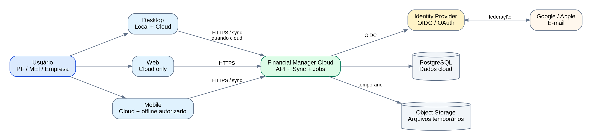
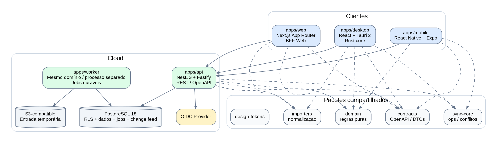
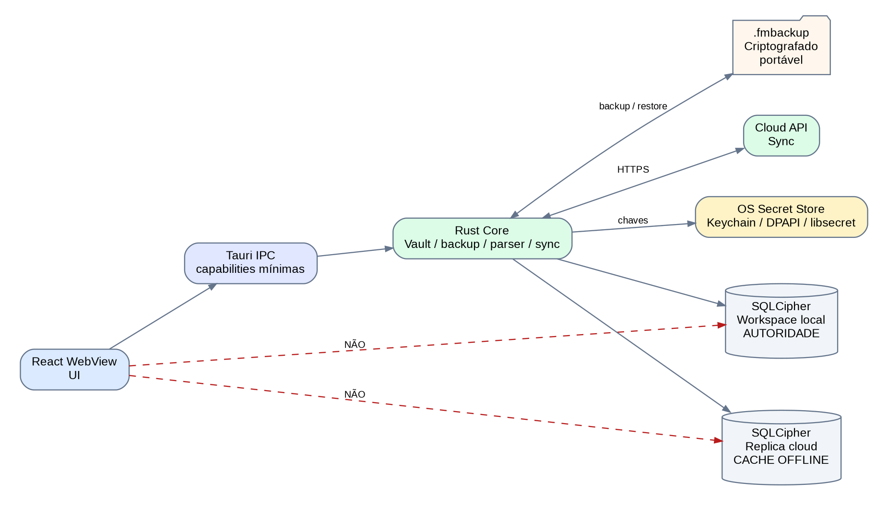
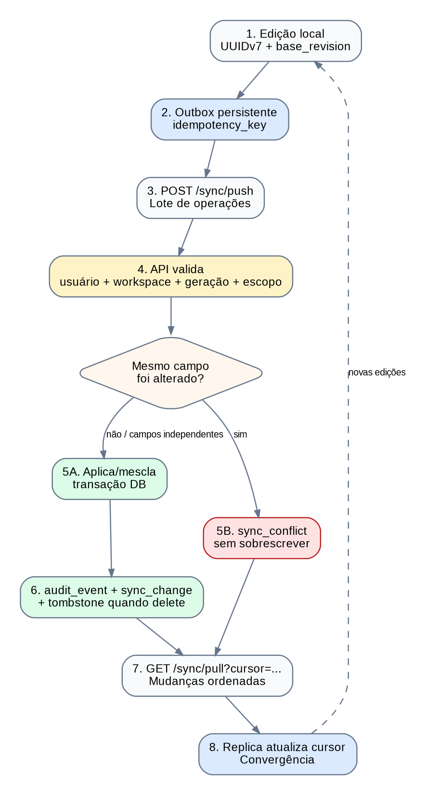
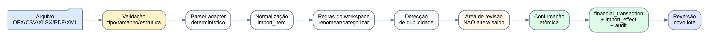
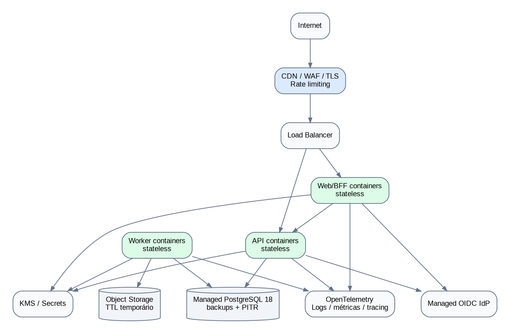
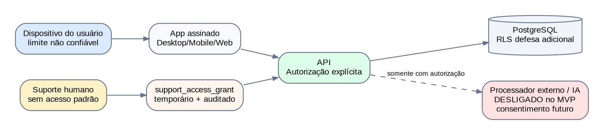

# Financial Manager — Arquitetura Técnica do MVP
## Documento de arquitetura · v1.0 · 05/10/2026

> Objetivo: transformar o PRD, o Mapa de Telas e Fluxos e o Modelo de Dados/ERD em uma arquitetura implementável para Desktop, Web, Mobile e Cloud, preservando o princípio de privacidade por workspace e evitando complexidade operacional prematura.

### Status deste documento

- **Decisão consolidada**: deriva de requisitos já aprovados.
- **Decisão arquitetural**: escolha técnica recomendada para o MVP.
- **Proposta a validar**: parâmetro que precisa de spike, teste de carga, segurança ou custo antes do beta.
- O documento descreve o **MVP**; Open Finance, IA generativa, self-hosting empresarial e microserviços ficam preparados por interfaces, não implementados antecipadamente.

---

## 00 · Sumário executivo

A arquitetura recomendada é um **monorepo TypeScript com um backend em monólito modular**, três clientes distintos e um pequeno núcleo Rust no Desktop:

- **Web**: Next.js App Router, somente workspaces cloud e sem persistência financeira durável no navegador.
- **Desktop**: React + Tauri 2; suporta workspaces locais anônimos e workspaces cloud com réplica offline. Persistência financeira e chaves ficam atrás do core Rust.
- **Mobile**: React Native + Expo; somente workspaces cloud, com réplica offline criptografada quando autorizada.
- **Cloud API**: NestJS + Fastify, REST/JSON + OpenAPI, autenticação externa via OIDC, autorização por workspace e Row-Level Security como defesa adicional.
- **Banco cloud**: PostgreSQL 18.x para produção do MVP. PostgreSQL 19 ainda está em ciclo beta em 05/10/2026 e não deve ser a base inicial de produção.
- **Banco local**: SQLite + SQLCipher. Desktop acessa por Rust; Mobile usa `expo-sqlite` com SQLCipher em build nativo.
- **Sincronização**: outbox persistente no cliente + change feed ordenado no servidor + UUIDv7 + idempotência + geração de sincronização + conflitos explícitos.
- **Infraestrutura**: containers OCI e componentes substituíveis; referência SaaS na AWS em região brasileira, mas o domínio não depende de serviços proprietários.
- **Processamento assíncrono**: worker do mesmo código de domínio e fila durável baseada em PostgreSQL no MVP. Redis/Kafka/SQS não são requisitos iniciais.

O objetivo é conseguir crescer de um beta fechado para dezenas de milhares de usuários sem uma reescrita arquitetural e, ao mesmo tempo, manter um caminho realista para self-hosting no futuro.

---

## 01 · Princípios arquiteturais

1. **Workspace é a fronteira de segurança e cobrança.** Nenhum recurso financeiro é autorizado apenas porque o usuário está autenticado.
2. **Local e cloud são autoridades diferentes.** Workspace local existe somente no Desktop; cache offline de cloud nunca vira silenciosamente um workspace local.
3. **Privacidade por minimização.** O sistema não envia arquivo ou dado para servidor quando a operação pode ser concluída localmente sem prejudicar o recurso solicitado.
4. **Servidor autoritativo para cloud.** Clientes cloud podem trabalhar offline, mas o estado confirmado do workspace compartilhado é o estado aceito pelo servidor.
5. **Conflito financeiro não é resolvido silenciosamente.** Atualizações concorrentes do mesmo campo geram conflito explícito; campos independentes podem ser mesclados.
6. **Exatidão antes de conveniência.** Dinheiro nunca usa ponto flutuante; IDs sincronizáveis não dependem de autoincremento.
7. **Modularidade antes de microserviços.** Fronteiras de domínio são explícitas no código, mas o backend permanece um deploy principal enquanto escala e equipe não justificarem separação.
8. **Cloud substituível.** Postgres, objeto S3-compatible, OIDC e containers são contratos arquiteturais; AWS é implantação de referência, não dependência do domínio.
9. **Sem telemetria financeira.** Valores, descrições, itens, CPF/CNPJ e nomes de arquivo não entram em logs operacionais ou analytics de produto.
10. **Mudanças destrutivas são reversíveis quando possível.** Imports, exclusões, migrações e alterações de schema possuem trilha, idempotência e estratégia de recuperação.

---

## 02 · Arquitetura de contexto



### 02.1 Responsabilidade por plataforma

| Capacidade | Desktop | Web | Mobile |
| --- | --- | --- | --- |
| Workspace local anônimo | **Sim** | Não | Não |
| Workspace cloud | Sim | Sim | Sim |
| Edição offline cloud | Sim, se autorizada | Não no MVP | Sim, se autorizada |
| Cofre criptografado local | Sim | Não | Réplica cloud criptografada |
| Backup local portável | Sim | Não | Não |
| Migração Local <-> Cloud | **Conduz** | Observa estado | Observa estado |
| Login | Opcional para local | Obrigatório | Obrigatório |

A Web não terá IndexedDB/SQLite como fonte financeira do MVP. Service Worker pode cachear shell, fontes e assets, mas respostas contendo lançamentos, saldos, documentos ou membros usam política `no-store` e não formam um modo offline recuperável.

---

## 03 · Stack recomendada

### 03.1 Monorepo

**Decisão arquitetural:** `pnpm` workspaces + Turborepo (ou ferramenta equivalente com o mesmo contrato) para compartilhar tipos, domínio, contratos, testes e design tokens sem obrigar interfaces iguais em DOM e React Native.

```text
financial-manager/
├─ apps/
│  ├─ web/          # Next.js App Router + BFF
│  ├─ desktop/      # React/Vite + Tauri 2 + Rust
│  ├─ mobile/       # Expo / React Native
│  ├─ api/          # NestJS + Fastify
│  └─ worker/       # jobs assíncronos, mesma base de domínio
├─ packages/
│  ├─ domain/       # regras puras e tipos financeiros
│  ├─ contracts/    # OpenAPI, schemas e clientes gerados
│  ├─ sync-core/    # operações, cursor e conflito
│  ├─ importers/    # parsers e normalização
│  ├─ search/       # normalização e contratos de busca
│  ├─ design-tokens/
│  ├─ ui-dom/       # Web + Desktop
│  └─ test-fixtures/
└─ infra/           # containers, IaC e ambientes
```

### 03.2 Escolhas por camada

| Camada | Escolha MVP | Motivo |
| --- | --- | --- |
| Web | React + Next.js App Router | SSR/BFF, roteamento maduro e boa separação servidor/cliente |
| Desktop | React + Vite + Tauri 2 | UI compartilhável com Web e core nativo pequeno, assinado e restrito por capabilities |
| Mobile | React Native + Expo | Um código Android/iOS, SQLite/SQLCipher suportado em build nativo e SecureStore para segredos |
| Backend | NestJS + Fastify | Organização modular, DI, OpenAPI e adapter HTTP eficiente |
| Banco cloud | PostgreSQL 18.x | Relacional, constraints, transações, FTS, RLS e UUIDv7 nativo |
| Banco local | SQLite + SQLCipher | Offline, transacional, portátil e adequado a cofres/replicas por dispositivo |
| API | REST JSON + OpenAPI | Simples de versionar, depurar e gerar clientes nas três plataformas |
| Identidade | OIDC/OAuth 2.0 por provider externo | Não armazenar senha no banco de aplicação; Google/Apple/e-mail sem acoplamento ao domínio |
| Objetos | S3-compatible | Arquivos temporários e futuro self-hosting via adapter |
| Jobs | Fila durável no PostgreSQL + worker | Menos infraestrutura no MVP; adapter permite migrar para broker depois |
| Observabilidade | OpenTelemetry + logs estruturados + error tracking com scrub | Correlação fim a fim sem registrar conteúdo financeiro |

**Versões:** fixar versões exatas no lockfile no início de cada milestone. Não usar PostgreSQL 19 beta em produção. Atualizações de framework devem passar pela suíte de regressão de importação, sync e autorização antes de entrar no beta.

---

## 04 · Containers e fronteiras de código



### 04.1 Backend como monólito modular

`apps/api` é um único serviço lógico com módulos internos. Cada módulo expõe casos de uso e portas, não tabelas diretamente.

```text
Identity       Workspaces      Permissions
Accounts       Transactions    Categories/Tags
Imports        Documents       Reconciliation
Search         Sync            Audit
Lifecycle      Export          Billing (mínimo)
```

**Regra:** um módulo não consulta tabela de outro módulo diretamente para “atalhar” uma regra. Integração interna ocorre via serviço de aplicação/porta ou por transação orquestrada em uma camada explícita.

O `worker` usa os mesmos pacotes de domínio e repositories, mas roda em processo separado para operações demoradas. Isso não é um microserviço: mesma versão, mesmo schema, mesmo ciclo de deploy e sem API pública própria.

### 04.2 O que não entra no MVP

- API GraphQL paralela;
- event bus distribuído;
- Kafka;
- Redis obrigatório;
- Elasticsearch/OpenSearch;
- service mesh;
- Kubernetes como requisito funcional;
- banco separado por workspace;
- microserviço por domínio.

Esses componentes só entram depois de uma métrica concreta mostrar necessidade.

---

## 05 · Arquitetura do Desktop



### 05.1 Fronteira Tauri

O WebView não recebe acesso SQL genérico, filesystem amplo, shell ou secrets. A interface React chama **comandos Tauri tipados e estreitos** como `create_transaction`, `import_preview`, `create_backup` ou `sync_push`. O core Rust valida payloads novamente e controla a conexão com o cofre.

Essa decisão aproveita o modelo de capabilities/permissões do Tauri 2 e reduz o impacto de uma falha de XSS no frontend do Desktop.

### 05.2 Cofre local

Para um workspace exclusivamente local:

- banco SQLCipher é a **autoridade**;
- não existe `cloud_user`, `workspace_member` ou token remoto;
- o arquivo da base fica no diretório privado da aplicação;
- a chave do banco é aleatória e guardada no secret store do sistema operacional;
- PIN/biometria opcional protege a liberação da chave, não substitui criptografia do banco;
- `foreign_keys=ON`, journaling e verificação de integridade são aplicados na abertura;
- backup é explícito e restaurável em outra instalação.

**Proposta v1:** `synchronous=FULL` para workspace local autoritativo; réplica cloud pode usar `NORMAL` se os testes de falha confirmarem recuperação correta pela fila/outbox.

### 05.3 Backup `.fmbackup`

Formato versionado e autenticado, contendo no mínimo:

```text
manifest.json
payload.enc
checksums/authentication metadata
```

Fluxo: snapshot consistente → validação `integrity_check` → criptografia com biblioteca auditada → gravação atômica em arquivo temporário → rename → verificação de leitura. A senha/chave de backup é independente da chave do dispositivo. Não criar algoritmo criptográfico próprio.

Na restauração: validar versão e autenticação antes de escrever; restaurar para staging; executar migrations compatíveis; validar invariantes; somente então substituir/registrar o novo cofre.

### 05.4 Distribuição

Windows 11 x64 é o primeiro alvo homologado do beta. Pacotes Desktop devem ser assinados. O updater Tauri usa artefatos assinados; chave privada de assinatura fica fora do CI comum, em secret store com acesso restrito. macOS/Linux podem ser adicionados sem alterar o domínio, mas não são declarados suportados antes de testes e assinatura apropriada.

---

## 06 · Arquitetura Web

### 06.1 Next.js como UI + BFF

A Web usa App Router e um **Backend-for-Frontend** leve para manter tokens OIDC fora do JavaScript do navegador. Sessão do navegador usa cookie `HttpOnly`, `Secure`, `SameSite` apropriado e CSRF protection nas mutações.

O BFF não implementa regras financeiras duplicadas. Ele:

1. conclui login OIDC;
2. mantém/renova sessão;
3. encaminha chamadas autenticadas à API;
4. aplica headers de segurança e `no-store` para dados financeiros.

### 06.2 Política de dados do navegador

- não persistir lançamentos/saldos/documentos em IndexedDB/localStorage;
- tokens não ficam em localStorage;
- cache HTTP de endpoints financeiros é desabilitado;
- Service Worker não intercepta/salva payload financeiro;
- preferências de UI sem conteúdo financeiro podem ser persistidas;
- logout remove sessão web, não altera workspaces locais no Desktop.

### 06.3 Segurança Web

CSP restritiva, Trusted Types quando viável, dependências de terceiros mínimas, sem scripts de analytics com acesso ao DOM financeiro. Uploads usam limites, MIME sniffing e endpoints dedicados. O frontend nunca confia em permissões ocultando botões: autorização real é na API.

---

## 07 · Arquitetura Mobile

### 07.1 Expo / React Native

Mobile exige login. Não cria workspace local anônimo. Quando offline é autorizado, mantém uma réplica SQLCipher do workspace cloud.

`expo-sqlite` suporta SQLCipher em Android/iOS por config plugin, exigindo build nativo/prebuild; portanto o app de produção e os testes de segurança não dependem do Expo Go.

### 07.2 Segredos e sessão

Refresh token, chave da réplica e outros secrets pequenos usam SecureStore/Keychain/Keystore. Dados financeiros ficam no SQLCipher, nunca no SecureStore. Biometria pode proteger acesso à chave quando habilitada.

### 07.3 Exatidão de INT64 no JavaScript

O schema físico SQLite usa `INTEGER`, mas a fronteira JavaScript trata `amount_minor` como **string decimal canônica**. SELECTs retornam `CAST(amount_minor AS TEXT)`; inserts/updates recebem strings validadas que SQLite converte para inteiro de 64 bits. A API também serializa valores monetários como string, evitando perda por `Number` acima de `2^53-1`.

Esse contrato é testado com os mesmos vetores no Desktop, Mobile, API e PostgreSQL.

---

## 08 · API e contratos

### 08.1 REST/OpenAPI

Base proposta: `/v1`. Recursos são orientados a workspace e usam keyset pagination.

Exemplos:

```text
GET  /v1/workspaces/{workspaceId}/transactions?after=...
POST /v1/workspaces/{workspaceId}/transactions
POST /v1/workspaces/{workspaceId}/imports/{batchId}/confirm
POST /v1/workspaces/{workspaceId}/sync/push
GET  /v1/workspaces/{workspaceId}/sync/pull?cursor=...
POST /v1/workspaces/{workspaceId}/exports
```

Mutações críticas aceitam `Idempotency-Key`. Respostas incluem `request_id`; entidades sincronizáveis carregam `revision`/`version` e `updated_at` técnico.

### 08.2 Contrato monetário

```json
{
  "amountMinor": "18350",
  "currencyCode": "BRL"
}
```

Nunca enviar `183.50` como `float` canônico. Formatação `R$ 183,50` pertence à UI.

### 08.3 Erros

Erro padrão contém código estável, mensagem segura, `request_id` e campos estruturados. Nunca ecoar SQL, caminho interno, stack trace, token ou conteúdo de documento.

```json
{
  "code": "SYNC_CONFLICT",
  "message": "Há uma alteração concorrente que precisa de revisão.",
  "requestId": "...",
  "details": {"conflictId": "..."}
}
```

---

## 09 · Identidade e autenticação

### 09.1 Provider OIDC separado

A aplicação guarda apenas `issuer`, `subject` e vínculos necessários em `auth_identity`. Senhas e recuperação de senha permanecem no Identity Provider.

**MVP:** e-mail + Google + Apple. Vinculação de provedores exige uma sessão que já prove controle das duas identidades; igualdade de e-mail não funde usuários automaticamente.

### 09.2 Web

Authorization Code + PKCE/BFF. Tokens ficam no servidor/BFF e a sessão do browser é cookie HttpOnly.

### 09.3 Desktop e Mobile

Authorization Code + PKCE em **browser do sistema**, não WebView embutida. Redirect por deep link/app link. Refresh token fica no secret store do SO. Aplicativos nativos são clientes públicos e não carregam client secret útil no binário.

### 09.4 MFA

MFA é capacidade do IdP. Frontend recomenda ativação e administradores podem futuramente impor políticas por workspace. O MVP não cria um segundo motor próprio de MFA.

---

## 10 · Autorização e isolamento multi-tenant

### 10.1 Duas barreiras

1. **API:** policy engine calcula permissão efetiva = papel base + capabilities + restrições + account scope + lifecycle + device/offline status.
2. **PostgreSQL RLS:** defesa adicional para tabelas tenant-scoped; não substitui a API.

Papéis: `OWNER`, `ADMIN`, `EDITOR`, `VIEWER`. Capabilities como `EXPORT_DATA`, `MANAGE_MEMBERS`, `DELETE_WORKSPACE`, `ALLOW_OFFLINE` são explícitas.

### 10.2 RLS recomendada

O role de runtime da API:

- não é owner das tabelas;
- não possui `BYPASSRLS`;
- opera dentro de transação;
- usa `SET LOCAL` para contexto do request;
- tabelas críticas usam `ENABLE ROW LEVEL SECURITY` e `FORCE ROW LEVEL SECURITY` onde apropriado.

Migrations usam role separado. Suíte automatizada tenta acesso cruzado entre workspaces em SELECT/INSERT/UPDATE/DELETE e exportação.

### 10.3 Integridade cross-workspace

Além de RLS, FKs críticas devem carregar `workspace_id` nos dois lados ou constraints equivalentes para impedir referência acidental entre tenants. Defesa em profundidade vale mais que confiar em uma única cláusula `WHERE`.

---

## 11 · Persistência cloud

### 11.1 PostgreSQL 18

PostgreSQL 18 é a base recomendada do MVP por ser a linha estável atual em 05/10/2026 e já oferecer UUIDv7 nativo, RLS, full-text search, constraints e transações robustas.

**IDs:** clientes geram UUIDv7 para entidades offline. Entidades exclusivamente server-side podem usar `uuidv7()` do PostgreSQL. Uma suíte valida compatibilidade RFC e ordenação entre implementações.

### 11.2 Data access

Preferir camada SQL-first/typed-query em vez de Active Record. O repository precisa permitir:

- SQL explícito para locks, RLS e keyset pagination;
- transações compostas;
- migrations versionadas;
- `SET LOCAL` de contexto;
- acesso a FTS/índices específicos.

A biblioteca concreta pode ser Kysely/Drizzle ou equivalente; escolher em spike curto. O contrato é mais importante que o ORM.

### 11.3 Índices e particionamento

Sem particionamento no dia 1. Índices principais seguem o ERD: `(workspace_id, occurred_on, id)`, `(workspace_id, account_id, occurred_on, id)`, estados de importação/sync e pesquisa de itens.

Particionar `audit_event`/`sync_change` somente quando volume real justificar. Não introduzir sharding antes de esgotar índices, VACUUM/autovacuum, pool e read patterns.

---

## 12 · Persistência local e schema dual

### 12.1 Postgres e SQLite não são clones byte a byte

Existe um **modelo lógico comum** com duas representações físicas. Migrations têm número de versão único e implementações por engine.

| Conceito | PostgreSQL | SQLite/SQLCipher |
| --- | --- | --- |
| UUID | `uuid` | `TEXT` canônico 36 chars ou BLOB 16 após spike |
| MoneyMinor | `BIGINT` | `INTEGER`, exposto ao JS como texto |
| Instante | `TIMESTAMPTZ` UTC | INTEGER epoch ms ou TEXT ISO, decisão testada |
| JSON variável | `JSONB` | `TEXT` JSON validado |
| Busca | FTS/`pg_trgm` quando necessário | FTS5 |
| RLS | Sim | Não; cofre já é isolado por arquivo/workspace |

### 12.2 Regra de compatibilidade

A suíte de invariantes roda contra Postgres e SQLite e deve produzir os mesmos resultados para saldo, transferência, cartão, rateio, importação, reversão e conflito. Diferença de resultado bloqueia release.

---

## 13 · Sincronização cloud



### 13.1 Modelo

Cada réplica mantém:

```text
workspace_id
sync_generation
server_cursor
last_successful_sync_at
outbox[]
conflicts[]
offline_access_expires_at
```

Cada operação da outbox contém:

```text
operation_id / idempotency_key
entity_type + entity_id
base_revision
patch + changed_fields
client_timestamp (informativo)
sync_generation
```

O relógio do cliente nunca decide vencedor. A ordem autoritativa é atribuída pelo servidor.

### 13.2 Push

Um lote é validado por autenticação, membership, escopo, geração e versão-base. O servidor processa cada operação em transação e retorna `APPLIED`, `MERGED`, `CONFLICT`, `REJECTED_PERMISSION` ou `STALE_GENERATION`.

### 13.3 Merge

- servidor compara campos alterados desde `base_revision` com `changed_fields` do cliente;
- interseção vazia → merge automático;
- mesmo campo alterado → `sync_conflict`;
- exclusão concorrente → conflito/estado específico, nunca ressuscitar silenciosamente;
- resolução humana cria nova operação auditada.

### 13.4 Pull

`sync_change` é feed ordenado por cursor monotônico do workspace. Pull retorna mudanças desde o cursor, incluindo tombstones. Cliente aplica em transação local e avança cursor somente após commit.

**Proposta v1:** manter change feed incremental por pelo menos 90 dias. Cursor mais antigo ou geração inválida recebe `SNAPSHOT_REQUIRED` e baixa snapshot atual.

### 13.5 Offline lease

A revogação remota não apaga um aparelho permanentemente offline. Para reduzir exposição, réplica cloud usa uma **lease de acesso offline** que exige revalidação periódica.

**Proposta v1:** 7 dias por padrão; owner pode desabilitar offline para o workspace. Ao expirar, dados permanecem criptografados no dispositivo, mas a aplicação exige conexão/autorização antes de liberar a réplica. Validar usabilidade no beta antes de ampliar/configurar o prazo.

---

## 14 · Migração Local <-> Cloud

### 14.1 Local → Cloud

1. Desktop executa `integrity_check` e sincroniza nenhuma outra autoridade, pois local é único.
2. Usuário autentica e escolhe migrar explicitamente.
3. API cria `workspace_migration`, membership OWNER e nova `sync_generation`, preservando `workspace.id`.
4. Desktop entra temporariamente em read-only para o snapshot inicial.
5. Registros são enviados em chunks idempotentes com manifesto de contagens/hashes.
6. Servidor grava em staging, valida FKs/invariantes/totais e somente então ativa o workspace.
7. Desktop recebe cursor inicial e converte seu banco em **réplica cloud**.
8. Falha antes do commit mantém o local como autoridade; retry usa a mesma migration id.

Nenhum outro workspace local é enviado.

### 14.2 Cloud → Local

1. Operação é exclusiva do OWNER e iniciada no Desktop.
2. API move workspace para `MIGRATING`, bloqueia novas mutações e incrementa/invalida geração antiga.
3. Desktop conclui pull e recebe snapshot final autoritativo.
4. Snapshot é verificado e convertido em novo cofre local com nova chave.
5. Somente após validação local a API arquiva o workspace cloud e revoga membros/dispositivos.
6. Cloud fica recuperável por **30 dias** conforme regra de produto; depois entra em purga lógica/física conforme política documentada.
7. Operações offline de geração anterior nunca são reaplicadas silenciosamente.

Restaurar o workspace cloud durante a janela cria outra `sync_generation` e força rebootstrap dos clientes.

---

## 15 · Importação de extratos



### 15.1 Onde o parsing acontece

| Fonte | Workspace local Desktop | Workspace cloud |
| --- | --- | --- |
| OFX/CSV/XLSX | Local | Preferencialmente no cliente; envia staging normalizado |
| XML NF-e/NFC-e | Local | Cliente quando possível; servidor como fallback |
| PDF textual | Local | Cliente/desktop; Web pode usar job temporário no servidor |
| Imagem/OCR | P1 local | P1; processador externo somente com autorização específica |

O objetivo é **não transferir o arquivo original quando o resultado pode ser obtido localmente**.

### 15.2 Pipeline

1. validar extensão, MIME, tamanho, encoding e estrutura;
2. desabilitar entidades externas de XML e recursos que permitam XXE;
3. parser produz modelo intermediário versionado;
4. normalização converte data, sinal, valor e descrição;
5. regras de workspace podem renomear/classificar;
6. motor de duplicidade cria candidatos com evidências;
7. usuário revisa `import_item`;
8. confirmação aplica tudo atomicamente e cria `import_effect`;
9. reversão é novo lote auditado.

### 15.3 Arquivos hostis

Parsers têm limites de tamanho, linhas, páginas, tempo, profundidade e memória. Arquivos compactados/planilhas não podem causar expansão ilimitada. Exportações CSV/Excel escapam fórmulas quando necessário. PDFs e XMLs nunca executam conteúdo ativo.

---

## 16 · Documentos fiscais e itens

### 16.1 Original temporário

O MVP não guarda o binário original como documento permanente. Quando servidor precisa processá-lo:

- upload usa URL assinada/endpoint temporário;
- bucket é criptografado;
- chave é aleatória e não contém CPF/CNPJ/nome de arquivo;
- processamento gera campos/itens/proveniência;
- delete é solicitado imediatamente após conclusão/cancelamento;
- lifecycle do bucket remove qualquer resíduo em até **24 horas** como defesa adicional (proposta v1).

### 16.2 Parsers

Adapters versionados por tipo (`NFE_XML`, `NFCE_XML`, `PDF_TEXT`, `RECEIPT`, etc.). Cada `document_extraction_run` registra parser/version e warnings. Um parser novo não reinterpreta automaticamente documentos confirmados; reprocessamento é uma ação explícita.

### 16.3 Conciliação

O serviço de matching trabalha com data, valor, contraparte, identificadores e contexto, mas produz apenas `PROPOSED`. A confirmação cria `document_transaction_allocation`. Match nunca altera lançamento financeiro original sem comando explícito.

---

## 17 · Busca

### 17.1 Contrato comum

A aplicação possui um `SearchRepository` com a mesma semântica em cloud e local. Normalização textual é controlada pela aplicação: Unicode, case folding, remoção/normalização de diacríticos quando aplicável, espaços e tokens.

### 17.2 Cloud

PostgreSQL full-text search para descrições, contrapartes e itens; `pg_trgm` pode ser habilitado somente se benchmark mostrar ganho para busca parcial/fuzzy. Nada de Elasticsearch no MVP.

### 17.3 Local

SQLite FTS5 para descrições, contrapartes e `document_item.normalized_name`. Índices FTS são derivados e podem ser reconstruídos; não são fonte de verdade.

---

## 18 · Jobs e processamento assíncrono

### 18.1 Fila

MVP usa tabela/fila durável em PostgreSQL e worker separado. Cada job tem `job_id`, tipo, workspace, estado, tentativas, `available_at`, lease/lock e idempotency key.

Casos:

- PDF parsing cloud;
- exportação grande;
- purga pós-retention;
- construção de snapshot de sync;
- manutenção de índice/rollup quando necessário.

Retry usa exponential backoff + dead-letter state. Job não pode executar duas vezes com efeito financeiro duplicado; handlers são idempotentes.

### 18.2 Quando migrar para broker externo

Somente se testes/produção mostrarem contenção ou necessidade de throughput/fan-out que Postgres não atende. O adapter permite trocar por SQS/RabbitMQ/NATS sem alterar caso de uso.

---

## 19 · Infraestrutura cloud de referência



### 19.1 Topologia SaaS

Referência inicial: AWS em região de São Paulo (`sa-east-1`), sujeita a validação de custos/serviços no provisionamento.

| Função lógica | Referência AWS | Contrato substituível |
| --- | --- | --- |
| Edge/CDN/WAF | CloudFront + WAF | CDN/reverse proxy com WAF |
| Load balancing | ALB | L7 load balancer |
| Web/API/Worker | ECS/Fargate | OCI containers |
| PostgreSQL | RDS PostgreSQL 18 | PostgreSQL gerenciado/self-host |
| Objetos temporários | S3 | S3-compatible |
| Secrets/KMS | Secrets Manager + KMS | Vault/KMS equivalente |
| Logs/metrics | CloudWatch + OTel backend | OpenTelemetry-compatible |
| Identity | Managed OIDC provider | Qualquer OIDC compliant |

### 19.2 Ambientes

- `dev`: dados sintéticos; sem acesso a produção;
- `staging`: mesma topologia lógica, escala menor, integrações de teste;
- `prod`: região brasileira, backups, WAF, chaves e contas separadas.

Infraestrutura como código. Nenhum deploy manual altera banco de produção fora do pipeline/registro de mudança.

### 19.3 Escala

Web/API/worker stateless permitem scale-out horizontal. O PostgreSQL é o primeiro ponto stateful a otimizar. Antes de sharding: índices, pool, query plans, autovacuum, batch, keyset pagination e réplicas de leitura quando justificadas.

A meta de 100 mil usuários é compatível com esse desenho, mas não representa concorrência. Testes de carga serão definidos por requests/s, usuários ativos simultâneos e tamanho de workspace.

---

## 20 · Segurança e trust boundaries



### 20.1 Principais ameaças

| Ameaça | Controles principais |
| --- | --- |
| Acesso cruzado entre workspaces | policy engine + RLS + FK/constraint + testes negativos |
| Roubo de notebook/celular | SQLCipher + secret store + bloqueio/biometria opcional |
| XSS/WebView comprometida | CSP + Tauri capabilities + core Rust não expõe SQL/filesystem genérico |
| Token roubado | PKCE, SecureStore, cookie HttpOnly, rotação/revogação e sessões por device |
| Arquivo malicioso | parsers limitados, validação, sem XXE, processamento isolado |
| Funcionário interno | sem acesso padrão; support grant temporário, least privilege e audit |
| Vazamento em observabilidade | scrub/allowlist; proibição de payload financeiro em logs |
| Cliente offline revogado | lease offline + criptografia + revalidação; limitação comunicada |
| Supply chain | lockfile, SCA, SBOM, assinatura de release e dependabot equivalente |
| Migração interrompida | staging + idempotência + generation + validação antes de trocar autoridade |

### 20.2 Suporte autorizado

Não existe “admin universal” de produto para abrir qualquer workspace. Atendimento solicita `support_access_grant`; owner autoriza escopo e duração; serviço emite sessão temporária separada; toda ação recebe actor/support identity e audit event. Expiração revoga automaticamente.

### 20.3 Criptografia

- TLS moderno em trânsito;
- criptografia de volume/banco/objeto no cloud via KMS;
- SQLCipher nos bancos locais/replicas;
- secrets fora de banco e logs;
- backups locais cifrados com formato autenticado;
- chaves de release separadas de chaves de dados.

O cloud **não é zero-knowledge** no MVP: a API precisa processar dados cloud para busca, sync e relatórios. Isso deve ser comunicado com honestidade; privacidade é obtida por finalidade, controle de acesso, minimização e auditoria, não por promessa de impossibilidade técnica de acesso.

---

## 21 · Observabilidade e auditoria

### 21.1 Operacional

Cada request/job/sync batch tem `request_id`/`trace_id`. OpenTelemetry instrumenta Web/BFF, API, worker e banco. Logs são JSON estruturado com allowlist.

Permitido:

```text
request_id, route_template, status_code, duration_ms,
workspace_id opaco, entity_type, error_code, parser_version
```

Proibido em logs/analytics:

```text
amount, transaction_description, document_item_name,
CPF/CNPJ, e-mail bruto desnecessário, arquivo bruto, token, cookie
```

### 21.2 Audit trail

`audit_event` é funcional e persistente, não substitui logs de infraestrutura. Eventos de maior risco: membro convidado/revogado, exportação, backup/migração, support grant, alteração de permissões, lote importado/revertido, exclusão e resolução de conflito.

---

## 22 · Backups, retenção e disaster recovery

### 22.1 Cloud

- backups criptografados e PITR do PostgreSQL;
- snapshot regular independente do lifecycle lógico do workspace;
- restauração ensaiada em ambiente isolado;
- object storage temporário não é backup de documento original;
- archive lógico de workspace por 30 dias é regra de produto, diferente de retenção técnica de backup.

**Proposta v1:** retenção técnica de backups de produção de até 35 dias. Quando um workspace é purgado, não volta ao banco ativo; fragmentos podem permanecer em backups imutáveis até expirar, sem serem reintroduzidos em uso normal.

### 22.2 Objetivos

O PRD aceita no beta RPO de até 24 h e RTO de até 8 h como teto inicial. A infraestrutura deve tentar superar isso com PITR, mas nenhum SLA menor é divulgado antes de simulação real de restauração.

### 22.3 Desktop local

Sem backup criado pelo usuário não há recuperação remota. O produto avisa isso de forma recorrente, mas não envia cópia local silenciosamente para a cloud.

---

## 23 · CI/CD e supply chain

### 23.1 Pipeline mínimo

```text
lint/typecheck
→ unit tests
→ domain invariant tests
→ Postgres + SQLite integration
→ authorization/RLS negative tests
→ sync convergence tests
→ import fixture tests
→ build containers/apps
→ SCA + secret scan + SBOM
→ staging migration + E2E
→ signed release
```

### 23.2 Database migrations

Expand/contract quando houver clientes offline com versões antigas. Migration incompatível nunca assume que todos os dispositivos atualizaram simultaneamente. API expõe `min_supported_client_version` e pode exigir atualização antes de permitir mutações perigosas.

### 23.3 Desktop/Mobile

Desktop: instaladores e updates assinados. Mobile: builds assinados; OTA update só para código compatível com o binário e, quando usado, deve ser assinado/validado conforme mecanismo adotado. Chaves de signing possuem rotação e backup operacional documentados.

---

## 24 · Estratégia de testes

### 24.1 Pirâmide específica do produto

| Tipo | O que prova |
| --- | --- |
| Unit/domain | sinais, saldo, cartão, rateio, regras de categoria |
| Contract | API/OpenAPI e serialização de MoneyMinor/UUID/date |
| Dual-engine | mesmo caso em PostgreSQL e SQLite |
| Import fixtures | bancos/documentos homologados, encoding e erros |
| Property-based | transferências conservam valor; reversão restaura estado válido |
| Sync convergence | dois/mais clientes chegam ao mesmo estado ou ao mesmo conflito explícito |
| Authorization | nenhum papel/escopo acessa recurso proibido |
| Backup/restore | snapshot local recupera exatamente o workspace |
| Migration | Local<->Cloud com falha em cada etapa e retry |
| E2E | fluxos do Mapa de Telas nas três plataformas |
| Security | upload hostil, token, CSRF/XSS, RLS, dependency scan |
| Load | metas RNF-07 a RNF-10 com datasets declarados |

### 24.2 Datasets

Fixtures não usam extratos reais de produção no CI. O extrato real autorizado pelo proprietário pode servir para validação manual e virar fixture sintética/desidentificada, preservando estrutura mas removendo dados pessoais.

---

## 25 · Desempenho

### 25.1 Metas herdadas do PRD

- painel/busca p95 ≤ 2 s em cenário homologado com 50 mil movimentos e 150 mil itens por workspace;
- API interativa p95 ≤ 800 ms excluindo rede do usuário;
- preview de 10 mil linhas em Desktop ≤ 30 s no hardware de referência;
- 100 operações simples de sync ≤ 10 s após conexão estável, salvo conflito.

### 25.2 Técnicas

Keyset pagination; queries parametrizadas; batch writes; índices por workspace; streaming de import; parse fora da UI thread; debounce de busca; worker para tarefas longas. Dashboard começa com queries indexadas; rollups/materialized summaries somente se medição exigir.

---

## 26 · Self-hosting futuro sem contaminar o MVP

A instalação empresarial futura deve conseguir substituir o SaaS por:

```text
Reverse proxy / TLS
OCI containers: web + api + worker
PostgreSQL
S3-compatible storage (ex.: MinIO)
OIDC provider (ex.: Keycloak ou equivalente)
SMTP
KMS/secret manager equivalente
OpenTelemetry collector
```

Regras para manter esse caminho aberto:

- domínio não importa SDK AWS;
- storage, queue, identity e email são adapters;
- migrations PostgreSQL são padrão;
- imagem de container não depende de metadata service específico;
- configuração por env/secret, não por console manual;
- feature flags e licença empresarial ficam fora do modelo financeiro.

Self-hosting, VPN e distribuição empresarial permanecem **fora do MVP**; apenas a compatibilidade arquitetural é mantida.

---

## 27 · Decisões arquiteturais (ADR resumido)

| ADR | Decisão | Status |
| --- | --- | --- |
| ADR-001 | Monorepo TS; Rust somente no core Desktop | Adotada |
| ADR-002 | Backend monólito modular + worker do mesmo domínio | Adotada |
| ADR-003 | REST/JSON + OpenAPI; sem GraphQL no MVP | Adotada |
| ADR-004 | PostgreSQL 18.x em produção; UUIDv7 | Adotada |
| ADR-005 | SQLite + SQLCipher local; Web sem DB financeiro | Adotada |
| ADR-006 | Desktop não expõe SQL genérico ao WebView | Adotada |
| ADR-007 | OIDC externo; Web BFF; Native Authorization Code + PKCE | Adotada |
| ADR-008 | Policy engine + PostgreSQL RLS como defesa em profundidade | Adotada |
| ADR-009 | Outbox + change feed + generation + conflitos explícitos | Adotada |
| ADR-010 | Import staging antes de afetar saldo | Herdada do produto |
| ADR-011 | Job queue em PostgreSQL no MVP; broker posterior por métrica | Adotada |
| ADR-012 | AWS Brasil como deploy de referência, domínio cloud-neutral | Proposta a validar custo |
| ADR-013 | Arquivo original temporário; TTL 24 h no cloud | Proposta v1 |
| ADR-014 | Offline lease cloud padrão 7 dias | Proposta v1 |
| ADR-015 | Backups cloud técnicos até 35 dias | Proposta v1 |

---

## 28 · Sequência técnica de implementação

### Fase A — spikes que bloqueiam decisões físicas

1. Tauri + SQLCipher + secret store + backup restaurado em outra instalação.
2. Expo + SQLCipher + SecureStore + MoneyMinor exato.
3. OIDC e-mail/Google/Apple com BFF Web e PKCE native.
4. PostgreSQL RLS com pool de conexões e `SET LOCAL` seguro.
5. Sync mínimo dois clientes: push, pull, conflict e tombstone.
6. Parser OFX/CSV com fixture de 10 mil linhas.

### Fase B — fundação do produto

Monorepo, contratos, migrations dual-engine, workspace/account/transaction/category, design tokens, CI/CD e observabilidade.

### Fase C — Desktop local

Cofre anônimo, transações, dashboard, importação, regras, busca, backup/restore.

### Fase D — Cloud/Web/Mobile

Identity, workspaces cloud, membros, permissões, RLS, API, Web BFF, Mobile online e auditoria.

### Fase E — Sync e migração

Offline Desktop/Mobile, conflitos, generation, Local→Cloud, Cloud→Local, archive/purge.

### Fase F — Documentos e hardening

XML/PDF homologados, itens, conciliação, exportação, load/security tests, assinatura de releases e beta fechado.

---

## 29 · Gates para liberar o beta

O MVP não deve abrir o beta enquanto qualquer item abaixo falhar:

- restauração de backup Desktop em outra máquina de teste;
- teste cruzado de autorização entre dois workspaces;
- same dataset → mesmos saldos Postgres/SQLite;
- sync converge ou produz conflito explícito sem perda silenciosa;
- Local→Cloud falha e retoma sem duplicar dados;
- Cloud→Local arquiva cloud somente após verificação do snapshot local;
- import idempotente não duplica saldo;
- reversão respeita alterações posteriores;
- atualização Desktop assinada é verificada;
- logs de staging não contêm valores/descrições/CPF/CNPJ de fixtures;
- restore cloud executado e medido;
- RNF de performance medidos no dataset homologado.

---

## 30 · Decisões ainda abertas

Estas escolhas não impedem iniciar a base, mas devem receber ADR antes do beta:

1. provedor OIDC gerenciado para SaaS e custo em 100 mil contas;
2. biblioteca SQL typed-query final no backend;
3. binding SQLCipher Rust final no Tauri;
4. representação UUID no SQLite: TEXT vs BLOB 16;
5. representação técnica de timestamp no SQLite;
6. biblioteca/parser PDF textual e lista inicial de layouts homologados;
7. implementação da fila PostgreSQL;
8. ferramenta final de error tracking/analytics com política de scrub;
9. custo/HA da topologia AWS de produção;
10. duração final da offline lease após teste de usabilidade/segurança.

---

## 31 · Rastreabilidade com documentos anteriores

| Requisito/decisão | Arquitetura correspondente |
| --- | --- |
| Desktop local anônimo | Seções 05, 12, 22 |
| Web cloud-only | Seção 06 |
| Mobile cloud/offline | Seções 07, 13 |
| Workspace como fronteira | Seções 01, 10 |
| Importação revisável/reversível | Seção 15 |
| Documento/itens pesquisáveis | Seções 16–17 |
| Cartão sem duplicidade | Domínio compartilhado + testes da seção 24 |
| Permissões Owner/Admin/Editor/Viewer | Seção 10 |
| Conflitos explícitos | Seção 13 |
| Local<->Cloud reversível | Seção 14 |
| Backup local | Seção 05.3 |
| Arquivamento 30 dias | Seções 14.2 e 22 |
| IA externa opt-in futura | Seções 01 e 20 |
| Self-hosting futuro | Seção 26 |

---

## 32 · Referências técnicas verificadas em 05/10/2026

- **PostgreSQL 18 — Release Notes / UUID Functions / Row Security Policies.** PostgreSQL Global Development Group. https://www.postgresql.org/docs/18/release-18.html · https://www.postgresql.org/docs/18/functions-uuid.html · https://www.postgresql.org/docs/18/ddl-rowsecurity.html
- **PostgreSQL 19 Beta 4.** Em 24/09/2026 a versão 19 ainda estava em beta; por isso este documento fixa 18.x como base inicial de produção. https://www.postgresql.org/about/news/postgresql-19-beta-4-released-3386/
- **Next.js App Router / Data Security / BFF guidance.** https://nextjs.org/docs/app · https://nextjs.org/docs/app/guides
- **OAuth 2.0 for Browser-Based Apps (RFC 10017) e Native Apps (RFC 8252), PKCE.** https://oauth.net/2/browser-based-apps/ · https://oauth.net/2/native-apps/ · https://oauth.net/2/pkce/
- **Expo SQLite / SQLCipher e SecureStore.** https://docs.expo.dev/versions/latest/sdk/sqlite/ · https://docs.expo.dev/versions/latest/sdk/securestore/
- **Tauri 2 — Security, Permissions, Distribution e Updater.** https://v2.tauri.app/security/ · https://v2.tauri.app/learn/security/using-plugin-permissions/ · https://v2.tauri.app/distribute/ · https://v2.tauri.app/plugin/updater/
- **NestJS Fastify adapter.** https://docs.nestjs.com/techniques/performance
- **SQLite FTS5.** https://www.sqlite.org/fts5.html

---

## 33 · Controle do documento

| Item | Valor |
| --- | --- |
| Documento | Arquitetura Técnica do MVP |
| Produto | Financial Manager |
| Versão | 1.0 |
| Data | 05/10/2026 |
| Fonte | PRD v1.0 + Mapa de Telas e Fluxos v1.0 + Modelo de Dados/ERD v1.0 |
| Próximo artefato recomendado | Backlog técnico / ADRs executáveis / plano de implementação |
