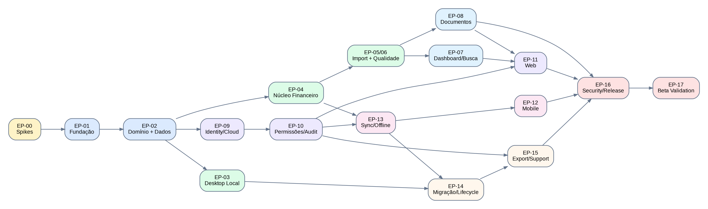
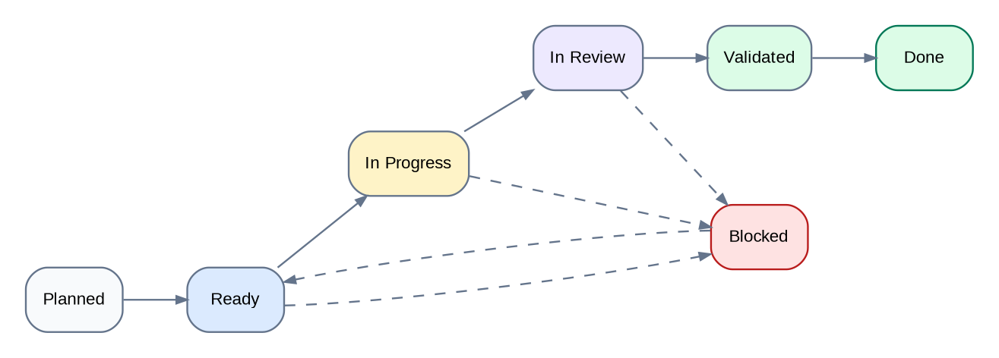

# Financial Manager — Backlog Técnico do MVP
## Backlog executável · v1.0 · 05/10/2026

> Objetivo: converter os quatro documentos-base do produto em uma fila técnica rastreável, priorizada e pronta para ser refinada em ferramenta de gestão (GitHub Projects, Jira, Linear ou equivalente), sem transformar estimativas em compromissos de calendário antes de conhecer a equipe.

## 00 · Sumário executivo

Este backlog contém **18 épicos** e **135 histórias técnicas/funcionais**, organizadas pela dependência real do produto. O caminho crítico parte de spikes físicos, passa por domínio e persistência dual-engine, entrega primeiro o valor local no Desktop e então adiciona Cloud/Web/Mobile, sincronização, migrações e hardening.

**Regra de execução:** P0 significa necessário para considerar o MVP concluído; P1 pode entrar sem deslocar segurança, integridade financeira ou gates de beta. Uma história só deve ser marcada Done quando seus critérios de aceite e testes aplicáveis tiverem evidência.

## 01 · Convenções de gestão do backlog

| Elemento | ID | Uso |
| --- | --- | --- |
| Epic | EP-xx | Entrega de domínio/infra com valor verificável |
| User/Technical Story | US-xxx | Unidade refinável com critérios de aceite |
| Task | TK-xxx | Subtarefa de implementação criada durante refinement |
| Bug | BUG-xxx | Desvio observado de requisito/contrato |
| ADR | ADR-xxx | Decisão técnica que altera ou fixa arquitetura |

### 01.1 Prioridade, tamanho e estado

- **P0:** necessário ao MVP/gate; **P1:** importante, mas não bloqueia o primeiro corte; **P2:** evolução.
- **S/M/L:** complexidade relativa para refinement. Não é prazo. História L deve ser reavaliada e, quando possível, quebrada antes de iniciar.
- Estados recomendados: Planned → Ready → In Progress → In Review → Validated → Done. `Blocked` é um estado transversal, não um destino.

### 01.2 Definition of Ready

- Objetivo e usuário/sistema impactado estão claros.
- Critérios de aceite são observáveis e não dependem de interpretação subjetiva.
- Dependências técnicas e de produto estão identificadas.
- Referências a PRD, fluxos, ERD ou ADR estão anexadas quando aplicável.
- Fixtures/dados de teste necessários existem ou fazem parte da própria história.
- Questões de segurança/privacidade foram explicitadas para operações sensíveis.

### 01.3 Definition of Done

- Código, migrations e contratos versionados foram revisados.
- Testes unitários/integração/contrato/e2e aplicáveis passam no CI.
- Telemetria não inclui conteúdo financeiro proibido.
- Mudança funciona em ambos engines quando a regra pertence ao domínio compartilhado.
- Documentação/ADR foi atualizada quando a implementação alterou uma decisão.
- Critério de aceite foi validado em ambiente adequado e evidência foi anexada ao item.

## 02 · Visão geral dos épicos

| Epic | Tema | Prio | Plataformas | Dependência | Resultado |
| --- | --- | --- | --- | --- | --- |
| EP-00 | Spikes arquiteturais e decisões físicas | P0 | Todas | - | Reduzir riscos técnicos que podem invalidar decisões de persistência, identidade, sync e importação. |
| EP-01 | Fundação do monorepo e engenharia | P0 | Todas | EP-00 parcial | Criar base reproduzível de desenvolvimento, contratos, CI/CD e observabilidade. |
| EP-02 | Domínio financeiro e persistência dual-engine | P0 | Todas | EP-00, EP-01 | Garantir mesma verdade financeira em PostgreSQL e SQLite. |
| EP-03 | Desktop local e cofre anônimo | P0 | Desktop | EP-01, EP-02 | Entregar o diferencial local: uso sem conta, criptografia, backup e restauração. |
| EP-04 | Núcleo financeiro e organização | P0 | D/W/M | EP-02 | Contas, saldo de referência, movimentações, transferências, cartão, categorias e rateios. |
| EP-05 | Pipeline de importação | P0 | D/W/M | EP-02, EP-04 | Receber OFX/CSV/XLSX/PDF homologado em staging, sem alterar saldo antes da confirmação. |
| EP-06 | Qualidade de dados, regras e reversão | P0 | D/W/M | EP-05 | Deduplicar, aplicar preferências, manter histórico e desfazer lotes com segurança. |
| EP-07 | Dashboard, relatórios e busca | P0 | D/W/M | EP-04, EP-06 | Explicar para onde o dinheiro foi e permitir chegar do agregado à evidência. |
| EP-08 | Documentos, itens e conciliação | P0 | D/W/M | EP-04, EP-06 | Extrair dados estruturados, pesquisar itens e conciliar documentos com movimentos. |
| EP-09 | Identidade e workspaces cloud | P0 | D/W/M | EP-00, EP-01, EP-02 | Cadastro/login e criação de espaços cloud sem misturar identidade com dados financeiros. |
| EP-10 | Permissões, colaboração e auditoria | P0 | D/W/M | EP-09 | Owner/Admin/Editor/Reader, escopo por conta, convites, revogação e audit trail. |
| EP-11 | Cliente Web cloud | P0 | Web | EP-07, EP-09, EP-10 | Operar workspaces cloud em navegador sem banco financeiro persistente. |
| EP-12 | Cliente Mobile cloud | P0 | Mobile | EP-09, EP-10, EP-13 base | Operação cloud mobile e réplica offline autorizada. |
| EP-13 | Sincronização, offline e conflitos | P0 | Desktop/Mobile/Cloud | EP-02, EP-09, EP-10 | Outbox, change feed, tombstones, generation e conflitos explícitos sem perda silenciosa. |
| EP-14 | Migração, ciclo de vida e recuperação cloud | P0 | D/W/M/Cloud | EP-03, EP-10, EP-13 | Local<->Cloud, arquivamento, exclusão, backup/restore e retenção operacional. |
| EP-15 | Exportação, suporte autorizado e privacidade operacional | P0 | D/W/M/Cloud | EP-10, EP-14 | Portabilidade, grants temporários de suporte e controles de exposição. |
| EP-16 | Segurança, observabilidade e release engineering | P0 | Todas | Transversal | Hardening, assinatura, supply chain, scrub de telemetria e operação segura. |
| EP-17 | Validação integrada e beta fechado | P0 | Todas | EP-03..16 | Executar CT-01..16 e abrir beta somente após gates verificáveis. |

## 03 · Backlog detalhado por épico

### EP-00 · Spikes arquiteturais e decisões físicas

**Resultado esperado:** Reduzir riscos técnicos que podem invalidar decisões de persistência, identidade, sync e importação.  
**Dependências:** -.  **Plataformas:** Todas.

| ID | História | Prio | Tam. | Referência | Critério de aceite resumido |
| --- | --- | --- | --- | --- | --- |
| US-001 | Spike Desktop: Tauri + SQLCipher + secret store + restauração em outra instalação | P0 | S | ADR-005/006; RF-32 | Demonstra cofre criptografado, key store do SO, backup autenticado e restore sem sobrescrever dados em falha. |
| US-002 | Spike Mobile: Expo + SQLCipher + SecureStore + MoneyMinor exato | P0 | S | ADR-005; RF-29 | Prova escrita/leitura offline e serialização de INT64 sem float em Android/iOS de teste. |
| US-003 | Spike OIDC: e-mail, Google e Apple com BFF Web e PKCE native | P0 | M | RF-01; ADR-007 | Fluxos de login/logout/recovery e callback funcionam sem senha no banco de aplicação. |
| US-004 | Spike PostgreSQL RLS com pool e contexto por request | P0 | S | RF-25–27; ADR-008 | Teste automatizado comprova que tenant A não lê/escreve tenant B mesmo diante de erro de filtro da aplicação. |
| US-005 | Spike de sync entre dois clientes | P0 | M | RF-29–31; ADR-009 | Push/pull, idempotência, tombstone e conflito de mesmo campo convergem sem perda silenciosa. |
| US-006 | Spike parser OFX/CSV com 10 mil linhas | P0 | S | RF-10–13 | Normalização completa dentro da meta de benchmark e sem alterar saldo. |
| US-007 | Fechar ADRs físicos bloqueadores | P0 | S | ERD §21; Arquitetura §30 | UUID SQLite, timestamps, binding SQLCipher, typed query, job queue e PDF parser têm decisão registrada ou spike pendente explícito. |

### EP-01 · Fundação do monorepo e engenharia

**Resultado esperado:** Criar base reproduzível de desenvolvimento, contratos, CI/CD e observabilidade.  
**Dependências:** EP-00 parcial.  **Plataformas:** Todas.

| ID | História | Prio | Tam. | Referência | Critério de aceite resumido |
| --- | --- | --- | --- | --- | --- |
| US-010 | Criar monorepo pnpm/Turborepo e fronteiras de packages | P0 | S | ADR-001 | Apps e packages compilam isoladamente; dependências proibidas falham no lint/CI. |
| US-011 | Configurar TypeScript, lint, format, testes e quality gates compartilhados | P0 | S | RNF-01..12 | Pull request falha em typecheck/lint/test quando aplicável. |
| US-012 | Criar package contracts com OpenAPI e clientes gerados | P0 | M | ADR-003 | Contrato versionado gera clientes tipados para Web/Desktop/Mobile. |
| US-013 | Criar package domain com MoneyMinor e regras puras | P0 | M | RF-05–08 | Nenhuma operação monetária central usa float; suíte cobre sinais, transferências e cartões. |
| US-014 | Configurar ambientes local/CI/integration/staging | P0 | M | Arquitetura §19/23 | Ambientes são reproduzíveis e não usam dados reais fora do beta autorizado. |
| US-015 | Configurar observabilidade base com scrub por padrão | P0 | S | RF-35; Arquitetura §21 | Trace/correlation id existem e fixtures sensíveis não aparecem em logs. |
| US-016 | Criar design tokens e shell UI compartilhável DOM/native | P0 | S | RNF-12 | Tokens de tipografia/espaçamento/estado têm pacote versionado e exemplos acessíveis. |
| US-017 | Feature flags e configuração por ambiente | P0 | S | Beta fechado | Funcionalidades incompletas podem ser desativadas sem fork de código. |

### EP-02 · Domínio financeiro e persistência dual-engine

**Resultado esperado:** Garantir mesma verdade financeira em PostgreSQL e SQLite.  
**Dependências:** EP-00, EP-01.  **Plataformas:** Todas.

| ID | História | Prio | Tam. | Referência | Critério de aceite resumido |
| --- | --- | --- | --- | --- | --- |
| US-020 | Implementar schema físico inicial PostgreSQL | P0 | M | ERD §03–08 | Workspace, contas, transações, categorias, allocations e revisões possuem constraints e FKs. |
| US-021 | Implementar schema físico equivalente SQLite | P0 | M | ERD §14 | Casos homologados produzem os mesmos saldos e invariantes que PostgreSQL. |
| US-022 | Criar framework de migrations dual-engine | P0 | M | ERD §17 | Upgrade/downgrade suportado onde previsto; migration interrompida não deixa schema intermediário inválido. |
| US-023 | Implementar UUIDv7 e política temporal consistente | P0 | S | ADR-004 | IDs são gerados por plataforma e ordenam aproximadamente por criação sem depender de relógio para regras de negócio. |
| US-024 | Implementar repositories/ports sem acesso cruzado indevido | P0 | M | Arquitetura §04 | Módulos não consultam tabela alheia por atalho; testes de arquitetura detectam violações. |
| US-025 | Criar fixtures financeiras canônicas | P0 | S | CT-06–08/16 | Mesmo dataset é carregável em ambos bancos e possui totais esperados versionados. |
| US-026 | Implementar revisão/versionamento de registros financeiros | P0 | M | RF-14, RF-30 | Cada alteração relevante gera revisão/base_revision apropriada. |
| US-027 | Suíte de invariantes cross-engine | P0 | M | ERD §12/20 | Transferências, rateios, cartão, saldo, reversão e exclusão passam em Postgres e SQLite. |

### EP-03 · Desktop local e cofre anônimo

**Resultado esperado:** Entregar o diferencial local: uso sem conta, criptografia, backup e restauração.  
**Dependências:** EP-01, EP-02.  **Plataformas:** Desktop.

| ID | História | Prio | Tam. | Referência | Critério de aceite resumido |
| --- | --- | --- | --- | --- | --- |
| US-030 | Tela de entrada Desktop com opção Continuar sem conta | P0 | S | EN-01; FL-01 | Usuário chega ao modo local sem criar identidade cloud. |
| US-031 | Criar workspace local anônimo | P0 | M | RF-02–03; WS-01 | Workspace local funciona sem cloud_user/auth_identity/workspace_member. |
| US-032 | Inicializar cofre SQLCipher e chave no secret store | P0 | M | RF-32; RNF-03 | DB não abre sem chave correta; segredo não é persistido em texto. |
| US-033 | Bloqueio/desbloqueio local opcional por PIN/biometria quando suportado | P0 | M | Privacidade local | Falha de autenticação não corrompe cofre e política é clara para usuário. |
| US-034 | Criar backup .fmbackup criptografado/versionado | P0 | M | BK-01; FL-14 | Backup contém manifesto autenticado, versão de schema e checksum. |
| US-035 | Restaurar backup como novo workspace | P0 | M | BK-02; FL-15 | Senha errada/adulteração falham antes de substituir qualquer dado existente. |
| US-036 | Gerenciar múltiplos workspaces locais ilimitados | P0 | S | RF-03 | Seletor distingue Local de Cloud e não impõe limite comercial. |

### EP-04 · Núcleo financeiro e organização

**Resultado esperado:** Contas, saldo de referência, movimentações, transferências, cartão, categorias e rateios.  
**Dependências:** EP-02.  **Plataformas:** D/W/M.

| ID | História | Prio | Tam. | Referência | Critério de aceite resumido |
| --- | --- | --- | --- | --- | --- |
| US-040 | CRUD de contas financeiras e saldo de referência | P0 | M | RF-05, RF-07; CT-02/05 | Conta tem natureza/tipo/moeda/saldo prévio e saldo calculado confere com fixtures. |
| US-041 | Criar/editar/excluir/restaurar movimentação manual | P0 | M | RF-06; MV-02/03/05 | Entrada/gasto atualizam apenas a conta correta e exclusão é reversível conforme regra. |
| US-042 | Transferência atômica entre contas | P0 | M | RF-05–07; FL-03 | Dois lados são criados/alterados juntos e não contam como consumo. |
| US-043 | Cartão simplificado como conta passiva | P0 | M | RF-08; CT-06 | Compra impacta consumo; pagamento de fatura não duplica despesa. |
| US-044 | Categorias padrão editáveis por workspace | P0 | S | RF-15 | Seed inicial pode ser renomeado/desativado sem afetar outros workspaces. |
| US-045 | Subcategorias, tags e associação às transações | P0 | S | RF-15 | Filtros e edição funcionam sem alterar saldo. |
| US-046 | Rateio de classificação via transaction_allocation | P0 | M | RF-20 | Soma das alocações respeita valor da transação e permite múltiplas categorias. |
| US-047 | Contrapartes normalizadas | P0 | S | RF-16 | Descrição original é preservada e contraparte normalizada pode ser reutilizada. |

### EP-05 · Pipeline de importação

**Resultado esperado:** Receber OFX/CSV/XLSX/PDF homologado em staging, sem alterar saldo antes da confirmação.  
**Dependências:** EP-02, EP-04.  **Plataformas:** D/W/M.

| ID | História | Prio | Tam. | Referência | Critério de aceite resumido |
| --- | --- | --- | --- | --- | --- |
| US-050 | Central de importações e histórico de lotes | P0 | M | IM-01/09 | Usuário vê origem, conta, status, contagens e resultado sem misturar lotes. |
| US-051 | Validação defensiva de arquivos | P0 | M | RF-10; Arquitetura §15 | Tipo/tamanho/estrutura hostil falham com erro seguro e sem execução de conteúdo. |
| US-052 | Parser OFX normalizado | P0 | M | RF-10 | Fixture homologada produz import_item determinístico com provenance. |
| US-053 | Parser CSV com mapeamento de colunas | P0 | M | IM-03 | Usuário confirma data/descrição/valor/sinal e salva mapping por layout quando permitido. |
| US-054 | Parser XLSX homologado | P0 | M | RF-10 | Leitura seleciona planilha/colunas sem executar macros/fórmulas externas. |
| US-055 | Staging/revisão pré-importação editável | P0 | L | RF-11; IM-05 | Nenhum item em staging altera saldo; usuário pode editar/incluir/excluir antes do commit. |
| US-056 | Confirmação atômica e idempotente do lote | P0 | M | RF-13; CT-03 | Repetir confirmação com mesma idempotency key não duplica transações. |
| US-057 | Executar parsers localmente quando plataforma permite | P0 | M | Privacy principle | Desktop não envia arquivo financeiro ao cloud para operação puramente local. |

### EP-06 · Qualidade de dados, regras e reversão

**Resultado esperado:** Deduplicar, aplicar preferências, manter histórico e desfazer lotes com segurança.  
**Dependências:** EP-05.  **Plataformas:** D/W/M.

| ID | História | Prio | Tam. | Referência | Critério de aceite resumido |
| --- | --- | --- | --- | --- | --- |
| US-060 | Detecção de duplicidade exata e provável | P0 | L | RF-12; IM-06 | Compras iguais legítimas podem ser mantidas; repetidos confirmados não entram por padrão. |
| US-061 | Comparação item atual x importado antes de atualizar | P0 | M | RF-12 | Diferenças ficam visíveis e personalizações do usuário são preservadas por padrão. |
| US-062 | Import rules versionadas por workspace | P0 | M | RF-16; FL-05 | Condição, ação, exemplos e escopo ficam auditáveis e não afetam outros workspaces. |
| US-063 | Sugerir regra após correção recorrente | P0 | S | IM-11 | Sugestão é opcional e mostra efeito antes de ativar. |
| US-064 | Registrar import_effect por item confirmado | P0 | M | RF-14 | Cada criação/atualização do lote conhece before/after necessário à reversão. |
| US-065 | Prévia de reversão com dependências posteriores | P0 | L | IM-10; CT-05 | Nenhuma alteração posterior é apagada silenciosamente; conflitos são listados. |
| US-066 | Executar reversão como novo evento/lote | P0 | M | FL-06 | Saldos e relatórios retornam ao estado correto e a reversão é auditável. |

### EP-07 · Dashboard, relatórios e busca

**Resultado esperado:** Explicar para onde o dinheiro foi e permitir chegar do agregado à evidência.  
**Dependências:** EP-04, EP-06.  **Plataformas:** D/W/M.

| ID | História | Prio | Tam. | Referência | Critério de aceite resumido |
| --- | --- | --- | --- | --- | --- |
| US-070 | Dashboard com saldo atual, despesas e composição | P0 | M | RF-23; VG-01 | Período selecionável, estado de confiança e drill-down para evidência. |
| US-071 | Relatório gastos por categoria | P0 | S | RF-24; RP-03 | Total confere com allocations e não inclui transferência/pagamento de fatura como consumo. |
| US-072 | Relatório entradas x saídas por período | P0 | S | RF-24; RP-04 | Semana/mês/semestre/ano e comparação usam o mesmo contrato de cálculo em todas plataformas. |
| US-073 | Comparação entre períodos | P0 | M | RP-05 | Diferença absoluta e relativa tratam base zero explicitamente. |
| US-074 | Busca global por movimentações/contrapartes/tags | P0 | M | DC-08 | Cloud e Local respeitam contrato comum de normalização/filtros. |
| US-075 | Drill-down agregado → evidência | P0 | S | FL-09 | Usuário sempre consegue abrir transação/documento que compõe um total. |
| US-076 | Estados vazio/erro/parcial/sem permissão | P0 | S | RNF-12 | Todas as telas agregadas distinguem ausência de dado de falha de carregamento. |
| US-077 | Compromissos futuros simples | P1 | M | RF-09 | Recurso fica feature-flagged e não bloqueia P0; somente dados verificáveis aparecem. |

### EP-08 · Documentos, itens e conciliação

**Resultado esperado:** Extrair dados estruturados, pesquisar itens e conciliar documentos com movimentos.  
**Dependências:** EP-04, EP-06.  **Plataformas:** D/W/M.

| ID | História | Prio | Tam. | Referência | Critério de aceite resumido |
| --- | --- | --- | --- | --- | --- |
| US-080 | Importar XML NF-e/NFC-e homologado | P0 | M | RF-17 | Extrai emitente, totais e itens mantendo provenance/version do parser. |
| US-081 | Extrair PDF textual homologado | P0 | L | RF-17–19 | Parser tem catálogo explícito por layout; PDF não homologado não é tratado como confiável. |
| US-082 | Tela de revisão de extração | P0 | M | DC-03 | Usuário corrige campos/itens antes de persistir como confirmado. |
| US-083 | Persistir documento estruturado e itens pesquisáveis | P0 | M | RF-20–21 | document_item suporta descrição normalizada, quantidade, unitário e total. |
| US-084 | Descartar original temporário conforme política | P0 | S | RF-18; CT-13 | Arquivo original não permanece além do TTL definido e não entra em logs. |
| US-085 | Busca por item com totalização correta | P0 | M | FL-08; CT-08 | Busca “energético” soma apenas linhas correspondentes, mesmo com conciliação múltipla. |
| US-086 | Conciliação N:N documento<->transação | P0 | L | RF-22; DC-07 | Permite um documento em vários pagamentos e vários documentos em um pagamento com alocação monetária válida. |
| US-087 | Sinalizar divergência entre itens e total | P0 | S | DC-06 | Diferença é visível; sistema não corrige valor silenciosamente. |

### EP-09 · Identidade e workspaces cloud

**Resultado esperado:** Cadastro/login e criação de espaços cloud sem misturar identidade com dados financeiros.  
**Dependências:** EP-00, EP-01, EP-02.  **Plataformas:** D/W/M.

| ID | História | Prio | Tam. | Referência | Critério de aceite resumido |
| --- | --- | --- | --- | --- | --- |
| US-090 | Criar conta por e-mail e fluxo de recuperação | P0 | M | RF-01; EN-03/04 | Credencial fica no IdP; aplicação recebe identidade estável e auditável. |
| US-091 | Login Google e Apple | P0 | M | RF-01 | Vinculação preserva conta existente e evita duplicação de identidade por e-mail quando seguro. |
| US-092 | Sessão Web via BFF e cookies seguros | P0 | M | ADR-007 | Tokens sensíveis não ficam expostos ao JS de aplicação. |
| US-093 | Sessão Desktop/Mobile via Authorization Code + PKCE | P0 | M | ADR-007 | Deep link/callback validado, refresh token protegido e logout revoga sessão quando suportado. |
| US-094 | Criar workspace cloud e owner inicial | P0 | M | RF-02–04 | Workspace é fronteira dos dados; owner é explícito e transferível. |
| US-095 | Seletor de múltiplos workspaces cloud | P0 | S | WS-03 | Troca invalida caches/queries do contexto anterior e refaz autorização. |
| US-096 | MFA individual/configurável no IdP | P0 | S | RF-28 | Front recomenda MFA e UI apresenta estado sem implementar credenciais próprias. |

### EP-10 · Permissões, colaboração e auditoria

**Resultado esperado:** Owner/Admin/Editor/Reader, escopo por conta, convites, revogação e audit trail.  
**Dependências:** EP-09.  **Plataformas:** D/W/M.

| ID | História | Prio | Tam. | Referência | Critério de aceite resumido |
| --- | --- | --- | --- | --- | --- |
| US-100 | Policy engine para Owner/Admin/Editor/Reader | P0 | L | RF-25–26 | Decisões são centralizadas e compartilhadas entre API e testes. |
| US-101 | Escopo por contas selecionadas e capacidades adicionais | P0 | L | RF-26 | Membro restrito não recebe saldo/movimento/documento fora das contas autorizadas. |
| US-102 | Invitar e aceitar membro | P0 | M | RF-27; FL-10 | Convite expira/é revogável e acesso só nasce após aceite. |
| US-103 | Editar papel/permissões e revogar acesso | P0 | M | FL-11 | Servidor bloqueia imediatamente; caches/offline entram em processo de revalidação/limpeza. |
| US-104 | Transferir propriedade do workspace | P0 | M | MB-05 | Não existe workspace cloud sem owner válido; operação exige autenticação recente. |
| US-105 | Auditoria cloud append-oriented | P0 | M | RF-41 | Ações sensíveis registram ator, escopo, tipo e metadados mínimos sem copiar conteúdo financeiro integral. |
| US-106 | PostgreSQL RLS como defesa adicional | P0 | M | CT-09 | Rotas críticas têm testes negativos cross-workspace e sessão DB define contexto de tenant corretamente. |
| US-107 | Permissão separada para exportação e offline | P0 | S | RF-38; SY-04 | Reader pode ser bloqueado de exportar/offline independentemente da leitura online. |

### EP-11 · Cliente Web cloud

**Resultado esperado:** Operar workspaces cloud em navegador sem banco financeiro persistente.  
**Dependências:** EP-07, EP-09, EP-10.  **Plataformas:** Web.

| ID | História | Prio | Tam. | Referência | Critério de aceite resumido |
| --- | --- | --- | --- | --- | --- |
| US-110 | Shell Next.js + navegação cloud | P0 | M | Mapa §01.2 | Sem login não existe rota financeira; workspace ativo é explícito. |
| US-111 | BFF para APIs cloud e tratamento uniforme de sessão | P0 | M | Arquitetura §06 | Chamadas client-side não expõem credenciais de longa duração. |
| US-112 | Implementar telas financeiras P0 na Web | P0 | L | VG/MV/CT/RP | Paridade de cálculo com fixtures e responsividade no recorte homologado. |
| US-113 | Implementar fluxo de importação Web | P0 | L | IM-01..10 | Arquivo é validado/uploadado/processado conforme política sem persistência financeira durável no browser. |
| US-114 | Implementar documentos/itens e busca Web | P0 | L | DC-01..08 | Fluxos P0 acessíveis e com estados de loading/erro claros. |
| US-115 | Implementar membros/configurações/lifecycle Web | P0 | L | MB/BK/EX | Ações destrutivas exigem autorização e confirmação adequadas. |
| US-116 | Acessibilidade Web: teclado, foco, semântica e reader | P0 | M | RNF-12; CT-16 | Fluxos críticos operáveis sem mouse e auditados com ferramenta + teste manual. |

### EP-12 · Cliente Mobile cloud

**Resultado esperado:** Operação cloud mobile e réplica offline autorizada.  
**Dependências:** EP-09, EP-10, EP-13 base.  **Plataformas:** Mobile.

| ID | História | Prio | Tam. | Referência | Critério de aceite resumido |
| --- | --- | --- | --- | --- | --- |
| US-120 | Shell Expo/React Native e navegação por workspace | P0 | M | Mapa §01.3 | Login obrigatório e contexto de workspace evidente. |
| US-121 | Telas financeiras P0 Mobile | P0 | L | VG/MV/CT/RP | Mesmas regras de cálculo; UX adaptada, não cópia do DOM. |
| US-122 | Importação Mobile via file picker/share sheet | P0 | M | IM-02 | Arquivos suportados entram no mesmo contrato de staging/revisão. |
| US-123 | Documentos e busca de itens Mobile | P0 | M | DC-01..08 | Usuário consegue importar, revisar e pesquisar itens no recorte do MVP. |
| US-124 | SQLite/SQLCipher da réplica cloud | P0 | L | RF-29 | Dados offline ficam criptografados e separados por workspace/device. |
| US-125 | SecureStore para segredos/sessão | P0 | S | Arquitetura §07 | Segredos não são colocados em AsyncStorage/plaintext. |
| US-126 | Acessibilidade Mobile e Dynamic Type | P0 | M | RNF-12 | Fluxos críticos funcionam com tamanhos de fonte maiores e labels de leitor de tela. |

### EP-13 · Sincronização, offline e conflitos

**Resultado esperado:** Outbox, change feed, tombstones, generation e conflitos explícitos sem perda silenciosa.  
**Dependências:** EP-02, EP-09, EP-10.  **Plataformas:** Desktop/Mobile/Cloud.

| ID | História | Prio | Tam. | Referência | Critério de aceite resumido |
| --- | --- | --- | --- | --- | --- |
| US-130 | Modelo de replica e cursor por workspace/device | P0 | M | RF-29 | Cliente sabe último cursor confirmado e sync_generation. |
| US-131 | Outbox persistente com idempotency_key/base_revision | P0 | L | ADR-009 | Reinício do app não perde operações pendentes. |
| US-132 | Endpoint sync push com validação de geração/permissão | P0 | L | RF-29–31 | Operação de cliente revogado/geração antiga não é aplicada. |
| US-133 | Change feed/pull ordenado e tombstones | P0 | L | RF-31 | Exclusão chega aos clientes e item antigo não ressuscita como novo. |
| US-134 | Merge de campos independentes e detecção de mesmo campo | P0 | L | RF-30 | Sem conflito quando edições são independentes; conflito explícito quando semântica colide. |
| US-135 | Central e tela de resolução de conflitos | P0 | L | SY-02/03; FL-13 | Mostra base/local/remoto, aplica decisão autorizada e gera nova revisão. |
| US-136 | Offline lease e revalidação | P0 | M | H-04/ADR-014 | Acesso offline tem prazo/configuração; expiração exige reconexão sem apagar dados antes da confirmação da política. |
| US-137 | Revogação com filas offline pendentes | P0 | M | FL-11 | Fila é revalidada antes de push e acesso removido não ganha segunda vida. |

### EP-14 · Migração, ciclo de vida e recuperação cloud

**Resultado esperado:** Local<->Cloud, arquivamento, exclusão, backup/restore e retenção operacional.  
**Dependências:** EP-03, EP-10, EP-13.  **Plataformas:** D/W/M/Cloud.

| ID | História | Prio | Tam. | Referência | Critério de aceite resumido |
| --- | --- | --- | --- | --- | --- |
| US-140 | Local→Cloud com snapshot validado e retomada | P0 | L | RF-33; FL-16 | Falha preserva origem local; sucesso valida contagens/totais antes de ativar cloud. |
| US-141 | Cloud→Local com ponto de corte e snapshot verificado | P0 | L | RF-34; FL-17 | Cloud só é arquivado após cofre local confirmado; generation invalida replicas antigas. |
| US-142 | Arquivar/restaurar workspace cloud | P0 | M | RF-37 | Arquivado sai da operação e pode ser restaurado dentro da janela definida. |
| US-143 | Exclusão definitiva e purge operacional | P0 | L | RF-37; CT-12 | Data de exclusão, retenção residual e reprocessamento após disaster restore são verificáveis. |
| US-144 | Backups cloud + PITR + restore runbook | P0 | L | RNF-06 | Restore é executado em ambiente de teste e medido, não apenas configurado. |
| US-145 | Gerenciar devices/offline access | P0 | M | SY-04 | Owner/admin consegue ver dispositivos autorizados e revogar lease. |

### EP-15 · Exportação, suporte autorizado e privacidade operacional

**Resultado esperado:** Portabilidade, grants temporários de suporte e controles de exposição.  
**Dependências:** EP-10, EP-14.  **Plataformas:** D/W/M/Cloud.

| ID | História | Prio | Tam. | Referência | Critério de aceite resumido |
| --- | --- | --- | --- | --- | --- |
| US-150 | Exportar movimentações CSV | P0 | M | RF-38 | Filtro/escopo respeitam permissão e valores são exatos. |
| US-151 | Exportar dataset estruturado JSON | P0 | L | RF-38–39 | Formato versionado permite portabilidade sem depender de telas. |
| US-152 | Prévia, escopo e mascaramento de exportação | P0 | M | EX-02 | Usuário sabe o que será exportado antes de gerar arquivo. |
| US-153 | Auditar exportações cloud | P0 | S | RF-41 | Evento registra ator, workspace, escopo, formato e horário sem guardar conteúdo exportado. |
| US-154 | Support access grant temporário | P0 | L | RF-40; FL-20 | Owner define motivo/escopo/expiração; sem grant suporte não acessa financeiro. |
| US-155 | Revogar/expirar grant de suporte | P0 | M | EX-04 | Expiração automática bloqueia acesso e deixa audit trail. |
| US-156 | Encerramento de conta sem destruir workspace alheio | P0 | M | RF-39 | Conta não é removida enquanto ownership necessário não for transferido ou workspaces tratados. |

### EP-16 · Segurança, observabilidade e release engineering

**Resultado esperado:** Hardening, assinatura, supply chain, scrub de telemetria e operação segura.  
**Dependências:** Transversal.  **Plataformas:** Todas.

| ID | História | Prio | Tam. | Referência | Critério de aceite resumido |
| --- | --- | --- | --- | --- | --- |
| US-160 | Threat model atualizado por trust boundary | P0 | M | Arquitetura §20 | Ameaças de tenant, sync, arquivo hostil, secret store e suporte têm mitigação/owner. |
| US-161 | Rate limit/WAF/limites de upload | P0 | M | RNF-01 | Abuso previsível não derruba serviço nem permite payloads ilimitados. |
| US-162 | Security headers/CSP/CSRF e cookies Web | P0 | M | Arquitetura §06.3 | Scanner e testes de sessão passam em staging. |
| US-163 | SAST/SCA/secret scan/SBOM no CI | P0 | M | Arquitetura §23 | Build de release falha em segredo exposto/vulnerabilidade acima da política. |
| US-164 | Assinar Desktop e validar updater | P0 | L | Gate beta | Update adulterado é rejeitado; canais beta/estável separados. |
| US-165 | Pipeline Mobile assinado e canais internos | P0 | M | Release | Build reproduzível e distribuição beta controlada. |
| US-166 | Scrub de logs/error tracking/analytics | P0 | M | RF-35; CT-13 | Fixtures com valores/descrições/CPF/CNPJ não aparecem em telemetria. |
| US-167 | Runbooks de incidentes, restore e rollback | P0 | M | RNF-06 | Operação consegue responder a vazamento, falha de deploy e restore testado. |

### EP-17 · Validação integrada e beta fechado

**Resultado esperado:** Executar CT-01..16 e abrir beta somente após gates verificáveis.  
**Dependências:** EP-03..16.  **Plataformas:** Todas.

| ID | História | Prio | Tam. | Referência | Critério de aceite resumido |
| --- | --- | --- | --- | --- | --- |
| US-170 | Automatizar e executar CT-01..08 | P0 | L | PRD §20 | Desktop local, backup, import, cartão, transferência e busca em itens validados. |
| US-171 | Automatizar e executar CT-09..15 | P0 | L | PRD §20 | Isolamento, sync, migração, lifecycle, privacidade, suporte e identity validados. |
| US-172 | Executar CT-16 e auditoria de acessibilidade | P0 | M | PRD §20 | Totais conferem nas três plataformas e fluxos críticos acessíveis. |
| US-173 | Performance/load benchmark homologado | P0 | M | RNF performance | Dataset/ambiente estão registrados e limites publicados. |
| US-174 | Security review e pentest focal | P0 | L | Barreiras de qualidade | Nenhuma vulnerabilidade alta/crítica conhecida permanece sem tratamento aprovado. |
| US-175 | Matriz de compatibilidade de bancos/documentos | P0 | M | H-02 | Beta publica formatos/layouts realmente homologados e limitações. |
| US-176 | Pacote operacional do beta fechado | P0 | M | PRD §20 | Privacidade/retenção, incidentes, suporte, feedback e métricas estão prontos. |
| US-177 | Go/No-Go do beta por gates | P0 | S | Arquitetura §29 | Checklist assinado registra evidência; falha crítica impede abertura. |

## 04 · Itens P1 preparados, mas não bloqueadores

| ID proposto | Item | Dependência | Regra de entrada |
| --- | --- | --- | --- |
| P1-01 | Lançamentos futuros e recorrências simples | EP-04/07 | Entrar somente se P0 financeiro estiver estável. |
| P1-02 | OCR local para imagens/documentos digitalizados | EP-08 | Entrar após medir precisão/custo e sem exigir IA externa. |
| P1-03 | Ampliação de PDFs/NFS-e homologados | EP-05/08 | Cada layout exige corpus de teste e versão de parser. |
| P1-04 | Política administrável de MFA por workspace | EP-09/10 | Não bloquear MFA individual do IdP. |
| P1-05 | Workflow de aprovação em dois níveis | EP-10 | Modelo pode estar preparado; UI/engine ficam pós-MVP. |

## 05 · Backlog transversal de qualidade

| Área | Trabalho obrigatório contínuo | Saída mínima |
| --- | --- | --- |
| Testes | Unitários de domínio, contract tests, dual-engine invariants, e2e críticos | CI impede regressão conhecida. |
| Segurança | Threat model, RLS negativos, upload hostil, dependency scan, secret scan | Nenhum bypass cross-workspace conhecido. |
| Privacidade | Scrub de logs, TTL de originais, revisão de analytics | Diagnóstico não copia conteúdo financeiro. |
| Acessibilidade | Teclado/foco/semântica Web, reader/Dynamic Type Mobile | CT-16 com evidência. |
| Performance | Dataset homologado, import 10k, queries dashboard/search, sync batch | Metas medidas e limites publicados. |
| Operação | Restore, rollback, incidentes, compatibilidade, suporte | Runbooks executáveis. |

## 06 · Rastreabilidade de épico para requisitos e fluxos

| Epic | PRD principal | Fluxos/telas principais |
| --- | --- | --- |
| EP-03 | RF-01–03, RF-32, RF-35 | EN-01, WS-01, BK-01/02, FL-01/14/15 |
| EP-04 | RF-05–08, RF-15/20 | MV-*, CT-*, CF-01/02, FL-03 |
| EP-05/06 | RF-10–16 | IM-01..11, FL-04/05/06 |
| EP-07 | RF-23–24 | VG-01/02, RP-01..06, FL-09 |
| EP-08 | RF-17–22 | DC-01..08, FL-07/08 |
| EP-09/10 | RF-01–04, RF-25–28, RF-40–41 | EN-02..05, WS-*, MB-*, EX-03/04, FL-10/11/20 |
| EP-13 | RF-29–31 | SY-01..04, FL-12/13 |
| EP-14 | RF-33–37 | BK-03..08, FL-16/17/18 |
| EP-15 | RF-38–40 | EX-01..04, FL-19/20 |
| EP-17 | PRD §20 CT-01..16 | Todos os fluxos P0 |

## 07 · Ordem recomendada de refinamento

1. EP-00 completo o suficiente para retirar incertezas bloqueadoras.
2. EP-01 e EP-02 prontos antes de expandir clientes.
3. EP-03 + EP-04 + EP-05/06 formam o primeiro slice de valor local.
4. EP-07/08 podem avançar em paralelo após contratos financeiros estabilizarem.
5. EP-09/10 devem estabilizar autorização antes de Web/Mobile e sync completo.
6. EP-13 precede offline Mobile e migrações reversíveis.
7. EP-16 é transversal desde o primeiro commit; EP-17 concentra a evidência final.

## 08 · Regras de triagem de bugs

| Severidade | Exemplo | Tratamento |
| --- | --- | --- |
| S0 | Vazamento cross-workspace, perda financeira reproduzível, backup irrecuperável | Bloqueia deploy/beta; hotfix e revisão de causa. |
| S1 | Duplicação de saldo, bypass de permissão, corrupção de import/sync | Bloqueia release candidate até correção. |
| S2 | Fluxo P0 quebrado com workaround seguro | Prioridade alta no milestone. |
| S3 | Problema visual/textual sem risco de integridade | Planejamento normal. |

## 09 · Controle do documento

| Item | Valor |
| --- | --- |
| Documento | Backlog Técnico do MVP |
| Produto | Financial Manager |
| Versão | 1.0 |
| Data | 05/10/2026 |
| Fonte | PRD v1.0 + Mapa de Telas v1.0 + ERD v1.0 + Arquitetura Técnica v1.0 |
| Próximo uso | Importar/refinar em ferramenta de gestão e vincular ao Plano de Implementação v1.0 |