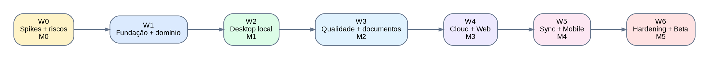
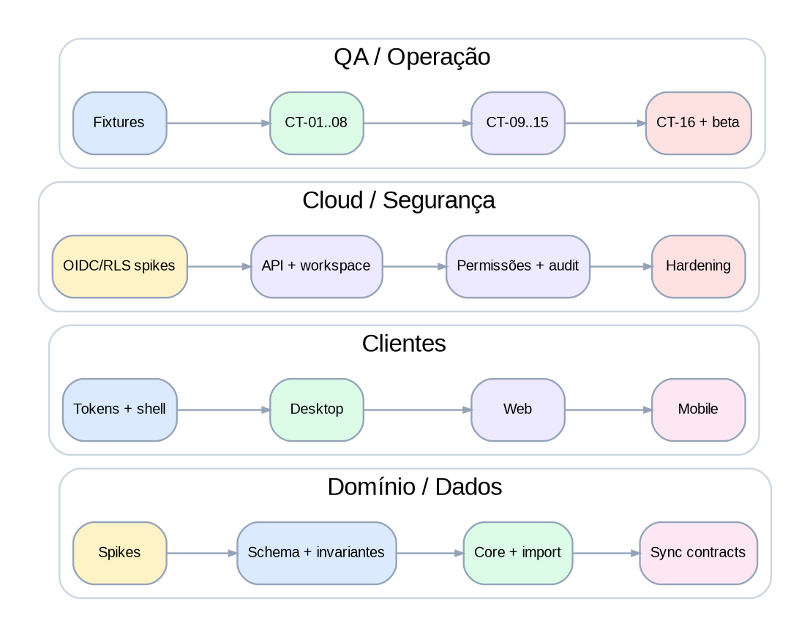
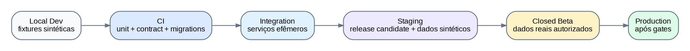

# Financial Manager — Plano de Implementação do MVP
## Plano de execução por dependências · v1.0 · 05/10/2026

> Objetivo: definir como executar o backlog técnico até um beta fechado integrado, sem assumir uma duração falsa antes de conhecer capacidade, composição da equipe e velocidade observada. O plano organiza ondas, trilhas paralelas, gates, ambientes, releases, testes e riscos.

## 00 · Estratégia de entrega

A implementação será guiada por **vertical slices verificáveis** e por gates de integridade. O produto não será desenvolvido como três clientes independentes: domínio, contratos, fixtures e políticas são compartilhados; cada plataforma implementa apenas a interface e capacidades que lhe pertencem.

O **Desktop local** é o primeiro slice de valor porque testa a proposta central sem depender de identidade/cloud. Cloud/Web entram quando modelo financeiro/importação já têm invariantes estáveis. Sync é provado em spike desde o início, mas sua implementação completa vem depois de identidade e autorização. Mobile entra sobre contratos cloud e sync já exercitados.

## 01 · Premissas e limites do plano

- Não há calendário fechado neste documento. Datas surgem somente após definição de equipe e 1–2 ciclos de throughput real.
- P0 do PRD é compromisso do MVP; P1 pode ser ativado se não deslocar gates de segurança/integridade.
- Arquitetura permanece monólito modular + worker; microserviços não são uma meta de entrega.
- Windows 11 x64 é o primeiro alvo Desktop proposto; Android/iOS entram no recorte Mobile. Homologação final deve ser registrada.
- Dados reais de participantes do beta só entram após privacidade, retenção, suporte e incident response estarem publicados.
- Cada milestone termina com demo + evidência de testes, não apenas merge de código.

## 02 · Trilhas de trabalho

| Trilha | Responsabilidade | Artefatos principais |
| --- | --- | --- |
| Domínio & Dados | Regras financeiras, schemas, migrations, importers, search, sync core | packages/domain, repositories, fixtures, migrations |
| Desktop | Tauri/Rust, cofre local, backup, local UI, sync cloud | apps/desktop |
| Cloud/API | NestJS, auth integration, workspaces, permissions, jobs, audit | apps/api + apps/worker |
| Web | Next.js+BFF e UX cloud | apps/web |
| Mobile | Expo/RN, SecureStore, replica/offline | apps/mobile |
| QA/Security/Ops | fixtures, CT-01..16, threat model, CI/CD, restore, releases | pipelines, runbooks, evidence |
| Produto/UX | linguagem, flows, acceptance, beta feedback | PRD/Mapa de telas + decisões de produto |

## 03 · Ondas de implementação e milestones

| Onda | Objetivo | Backlog | Saída verificável | Gate de saída |
| --- | --- | --- | --- | --- |
| W0 / M0 | Spikes e fundações de risco | EP-00 + parte EP-01 | Provas Tauri/SQLCipher, Expo/SQLCipher, OIDC, RLS, sync mínimo, parser 10k; ADRs bloqueadores fechados. | Não avançar se cofre/restore, RLS ou sync mínimo forem inviáveis na abordagem proposta. |
| W1 | Fundação compartilhada | EP-01 + EP-02 | Monorepo, CI, contratos, MoneyMinor, schemas PostgreSQL/SQLite, migrations e fixtures canônicas. | Mesmo dataset produz invariantes equivalentes nos dois bancos. |
| W2 / M1 | Valor local Desktop | EP-03 + EP-04 + parte EP-05/06/07 | Desktop anônimo: workspace, contas, lançamentos, OFX/CSV, revisão, duplicidade básica, dashboard, backup/restore. | FL-01 completo e CT-01/02/03/06/07 exercitados. |
| W3 / M2 | Qualidade, detalhe e documentos | restante EP-05/06/07 + EP-08 | XLSX, reversão, regras, busca, XML/PDF homologado, itens e conciliação. | FL-04..09 e CT-04/05/08/13 com evidência. |
| W4 / M3 | Cloud, colaboração e Web | EP-09 + EP-10 + EP-11 + base EP-16 | Identity, cloud workspace, roles/scopes, audit, Web, export permissions e hardening de autorização. | FL-02/10/11; CT-09/14/15; Web cobre P0 cloud online. |
| W5 / M4 | Sync, migração e Mobile | EP-13 + EP-14 + EP-12 + EP-15 | Replica/offline, conflitos, Local<->Cloud, lifecycle, Mobile, suporte autorizado/export completo. | FL-12..20; CT-10/11/12; Mobile com paridade de cálculo. |
| W6 / M5 | Hardening e beta fechado | EP-16 + EP-17 | Security/load/a11y, assinatura, runbooks, restore, compatibilidade, políticas e Go/No-Go. | CT-01..16 e todos gates da Arquitetura §29 aprovados. |

## 04 · Caminho crítico e paralelização

**Caminho crítico provável:** EP-00 → EP-02 → EP-04 → EP-05/06 → EP-09/10 → EP-13 → EP-14 → EP-17. Falhas nesses blocos afetam a integridade ou a capacidade de integrar as três plataformas.

Trabalho que pode ocorrer em paralelo, desde que os contratos estejam estáveis:
- Design tokens/shells podem avançar enquanto schemas e spikes são fechados.
- Documentos (EP-08) podem avançar após staging e modelo financeiro, sem aguardar Cloud completo.
- Web pode implementar telas read-only/online sobre mocks/contracts enquanto autorização é finalizada, mas não deve bypassar o BFF.
- Mobile UI pode começar com fixtures antes do sync completo; offline real só fecha após EP-13.
- QA prepara corpus, fixtures e automação desde W0; não começa apenas no M5.
- Segurança acompanha cada fronteira criada; hardening final não substitui revisão incremental.

### 04.1 Perfis de equipe sem alterar a ordem técnica

| Capacidade | Forma de trabalhar |
| --- | --- |
| 1–2 engenheiros | Executar quase serialmente o caminho crítico; adiar paralelismo de Web/Mobile até contratos estabilizarem. |
| 3–5 engenheiros | Separar Domínio/API, Desktop e Web/Mobile; QA/segurança compartilhados desde início. |
| 6+ engenheiros | Trilhas independentes com owners claros, mas manter ADRs, contracts e fixtures centralizados para evitar três produtos divergentes. |

## 05 · Sequência inicial de execução

As primeiras histórias a entrar em `Ready` devem minimizar retrabalho. Ordem recomendada:

1. **US-001** — Spike Desktop: Tauri + SQLCipher + secret store + restauração em outra instalação
2. **US-002** — Spike Mobile: Expo + SQLCipher + SecureStore + MoneyMinor exato
3. **US-003** — Spike OIDC: e-mail, Google e Apple com BFF Web e PKCE native
4. **US-004** — Spike PostgreSQL RLS com pool e contexto por request
5. **US-005** — Spike de sync entre dois clientes
6. **US-006** — Spike parser OFX/CSV com 10 mil linhas
7. **US-007** — Fechar ADRs físicos bloqueadores
8. **US-010** — Criar monorepo pnpm/Turborepo e fronteiras de packages
9. **US-011** — Configurar TypeScript, lint, format, testes e quality gates compartilhados
10. **US-013** — Criar package domain com MoneyMinor e regras puras
11. **US-020** — Implementar schema físico inicial PostgreSQL
12. **US-021** — Implementar schema físico equivalente SQLite
13. **US-022** — Criar framework de migrations dual-engine
14. **US-025** — Criar fixtures financeiras canônicas
15. **US-027** — Suíte de invariantes cross-engine
16. **US-030** — Tela de entrada Desktop com opção Continuar sem conta
17. **US-031** — Criar workspace local anônimo
18. **US-032** — Inicializar cofre SQLCipher e chave no secret store
19. **US-040** — CRUD de contas financeiras e saldo de referência
20. **US-041** — Criar/editar/excluir/restaurar movimentação manual
21. **US-044** — Categorias padrão editáveis por workspace
22. **US-050** — Central de importações e histórico de lotes
23. **US-052** — Parser OFX normalizado
24. **US-053** — Parser CSV com mapeamento de colunas
25. **US-055** — Staging/revisão pré-importação editável
26. **US-056** — Confirmação atômica e idempotente do lote
27. **US-034** — Criar backup .fmbackup criptografado/versionado
28. **US-035** — Restaurar backup como novo workspace
29. **US-070** — Dashboard com saldo atual, despesas e composição

## 06 · Estratégia de ambientes e dados

| Ambiente | Dados | Deploy | Uso |
| --- | --- | --- | --- |
| Local Dev | Somente fixtures/sintéticos | on-demand | Desenvolvimento e testes rápidos. |
| CI | Fixtures determinísticas | efêmero | Unit/contract/migrations/security scans. |
| Integration | Sintéticos + serviços reais de teste | automático em main/PR conforme custo | API+DB+sync end-to-end. |
| Staging | Sintéticos realistas; nunca cópia indiscriminada de produção | release candidate | Smoke, load controlado, restore, a11y, security. |
| Closed Beta | Dados reais apenas de participantes consentidos | canal beta | Validação de valor e operação. |
| Production | Dados reais | promoção após gates | Disponibilidade geral futura. |

**Regra de dados:** não usar dump de produção em dev/staging. Casos que exigem realismo devem usar datasets sintéticos/anonimizados construídos especificamente para teste.

## 07 · Estratégia de branches, integração e releases

- Preferir trunk-based development com branches curtas e pull requests pequenos.
- Migrations devem ser backward-compatible no mesmo release sempre que possível; deploy de schema precede código que depende da nova coluna/estrutura.
- Feature flags protegem fluxos incompletos e permitem beta gradual sem branches de longa duração.
- Web/API/worker usam release versionada e rollback documentado; mudanças de contrato mantêm compatibilidade dentro de `/v1` ou exigem nova versão.
- Desktop possui canais internal/beta/stable, artefatos assinados e updater validado.
- Mobile usa canais internos/TestFlight/Play Internal antes do beta externo; schema local tem migration testada contra versão anterior suportada.

## 08 · Estratégia de testes por onda

| Onda | Testes dominantes | Evidência de saída |
| --- | --- | --- |
| W0 | spikes reproduzíveis, benchmark parser, isolamento RLS | scripts/ADR + resultado registrado |
| W1 | unitários de domínio, migrations, invariantes cross-engine | fixtures canônicas verdes em PG/SQLite |
| W2 | e2e Desktop local, backup/restore, import idempotente | CT-01/02/03/06/07 parcial |
| W3 | dedupe/reversal/doc items/search | CT-04/05/08/13 |
| W4 | auth/permission negative tests, Web e2e, audit | CT-09/14/15 |
| W5 | property/convergence sync, migration fault injection, Mobile offline | CT-10/11/12 |
| W6 | CT-01..16 completo, load, a11y, pentest focal, restore drill | evidence pack para Go/No-Go |

## 09 · Segurança e privacidade dentro do ciclo

Segurança não é uma onda final. Cada merge que cria uma nova fronteira deve incluir os controles correspondentes:
- Novo endpoint → autorização, validação, rate limit relevante e teste negativo.
- Nova tabela workspace-scoped → FK/constraint, policy RLS quando cloud e teste cross-workspace.
- Novo arquivo/parser → limites, corpus hostil, timeout/memória e política de descarte.
- Novo evento de telemetria → revisão de payload para impedir conteúdo financeiro/identificadores desnecessários.
- Novo mecanismo offline → ameaça de dispositivo perdido, revogação e expiração.
- Nova ação destrutiva → autenticação recente quando aplicável, confirmação, audit trail e recuperação/retention claras.

## 10 · Plano de dados, fixtures e compatibilidade

| Conjunto | Conteúdo | Finalidade |
| --- | --- | --- |
| FIX-FIN-01 | contas, transferências, cartão, rateios, ajustes | invariantes financeiras |
| FIX-IMP-01 | OFX/CSV/XLSX com duplicatas e períodos sobrepostos | import/dedup/reversal |
| FIX-DOC-01 | NF-e/NFC-e XML e PDFs sintéticos/homologados | parsers, itens, busca |
| FIX-SYNC-01 | edições concorrentes, tombstones, generation antiga | convergência e conflito |
| FIX-ACL-01 | dois workspaces, roles e account scopes | isolamento/autorização |
| FIX-LIFE-01 | archive/purge/restore/migration | ciclo de vida e DR |

O catálogo de compatibilidade do beta deve listar banco/layout/versão realmente testado. “Suporta PDF” ou “suporta CSV” nunca deve significar suporte universal.

## 11 · Observabilidade e critérios operacionais

Instrumentar desde W1: request/trace id, latência API, falha de job, tamanho/tempo de import, atraso de sync, quantidade de conflitos, taxa de restore, erros por versão de cliente e saúde de migrations. Métricas devem evitar conteúdo financeiro.

| Sinal | Uso de decisão |
| --- | --- |
| p95 API/query | detectar necessidade de índice/cache/escala horizontal |
| lag/falha de jobs | decidir se fila PostgreSQL ainda é adequada |
| sync batch size/conflict rate | ajustar protocolo e UX; não esconder conflitos |
| import duration/failure by parser version | homologar layouts e priorizar correções |
| restore success/RTO | validar que backup é realmente recuperável |
| crash-free sessions por cliente | bloquear promoção de release instável |

## 12 · Riscos de execução e respostas

| Risco | Sinal precoce | Resposta |
| --- | --- | --- |
| Divergência PostgreSQL/SQLite | fixture gera total diferente | parar feature e corrigir domain/adapter antes de continuar. |
| Sync complexo demais | muitos conflitos falsos/loops | reduzir operações sincronizáveis e ampliar property tests; não usar last-write-wins silencioso. |
| Importadores frágeis | regressão por layout | versionar parser + corpus; homologação explícita. |
| Escopo cresce para ERP | novos módulos sem relação com problema central | usar P1/P2 e proteger objetivo “para onde meu dinheiro foi”. |
| Desktop vira WebView privilegiado | UI pede acesso SQL/FS genérico | manter capabilities mínimas e comandos nativos tipados. |
| Segurança atrasa no fim | gates falham somente em M5 | security tests e threat review em cada onda. |
| Custos cloud surpreendem | jobs/storage/egress crescem cedo | medir custo por workspace no beta; manter originais temporários. |
| Equipe pequena tenta paralelizar tudo | muitos itens em progresso | limitar WIP e seguir caminho crítico. |

## 13 · Critérios de Go/No-Go do beta

- CT-01..16 possuem evidência; itens não executados contam como falha, não como “assumidos”.
- Nenhum vazamento cross-workspace, perda/duplicação financeira reproduzível ou backup sem restore demonstrado.
- Local→Cloud e Cloud→Local passam por fault injection sem duplicar/perder dados.
- RLS + autorização da API têm testes negativos; leitor/export/offline respeitam escopo efetivo.
- Desktop release é assinado e updater rejeita artefato inválido.
- Restore cloud foi executado e RTO/RPO medidos no ambiente de referência.
- Logs/error tracking do staging não contêm valores, descrições financeiras, CPF/CNPJ ou originais.
- Compatibilidade, limitações do beta, retenção, privacidade, suporte e incidentes estão publicados.

## 14 · Processo de refinement e acompanhamento

- Refinar apenas 1–2 ondas à frente; não decompor todo o produto em microtarefas antes de aprender com implementação.
- Manter no máximo poucos itens por pessoa em In Progress; Blocked deve ter owner e condição de desbloqueio.
- Ao fechar um ADR que altera implementação, atualizar história afetada e documento de arquitetura antes do merge final.
- Cada milestone tem demo orientada pelos fluxos FL e não por componentes internos isolados.
- Bugs S0/S1 interrompem promoção de release; bugs S2/S3 entram no triage com impacto explícito.
- Após M1 e M3, revisar prioridades com evidência de uso antes de puxar P1.

## 15 · Entregáveis por milestone

| Marco | Demonstração mínima | Artefatos que devem acompanhar |
| --- | --- | --- |
| M0 | spikes executados e decisões físicas registradas | ADRs, benchmark, threat notes |
| M1 | instalar Desktop → criar local → importar → entender gastos → backup/restore | release internal, fixture report, CT evidence |
| M2 | dedupe/reversal + documentos/itens/search | compatibility catalog v0, parser corpus |
| M3 | login → cloud → colaboração → Web | auth/RLS evidence, audit report |
| M4 | offline/sync + Local<->Cloud + Mobile | convergence tests, migration fault report |
| M5 | beta fechado pronto | Go/No-Go checklist, privacy/retention, incident/restore runbooks |

## 16 · Controle do documento

| Item | Valor |
| --- | --- |
| Documento | Plano de Implementação do MVP |
| Produto | Financial Manager |
| Versão | 1.0 |
| Data | 05/10/2026 |
| Fonte | Backlog Técnico v1.0 + PRD/Fluxos/ERD/Arquitetura v1.0 |
| Próximo passo | Refinar W0/W1 em ferramenta de gestão e executar spikes bloqueadores |